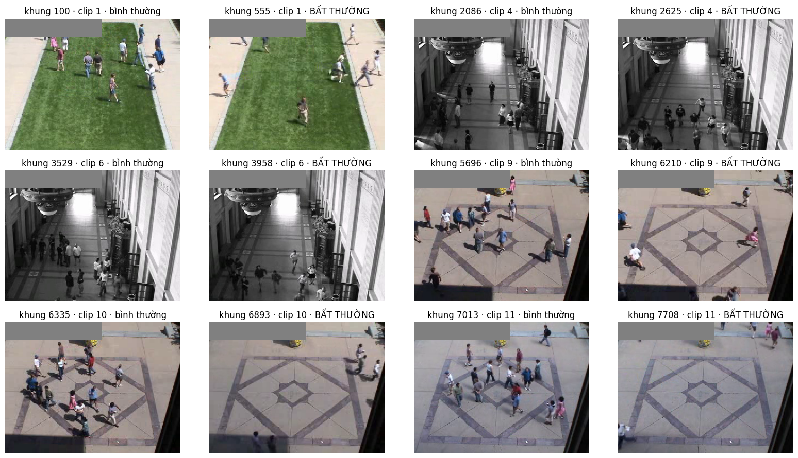
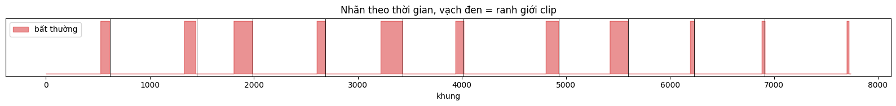
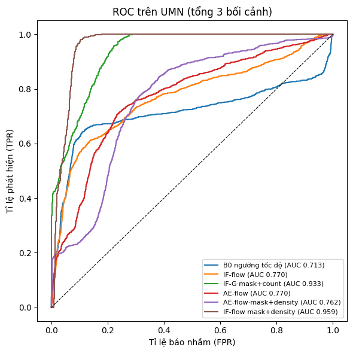
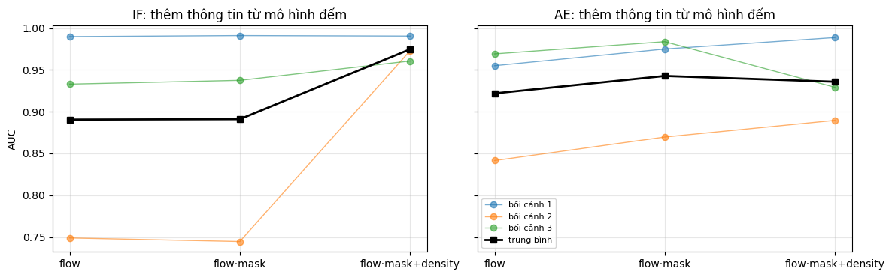
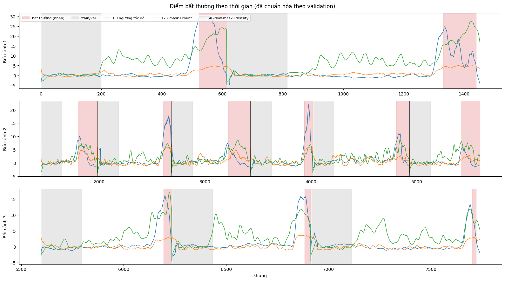
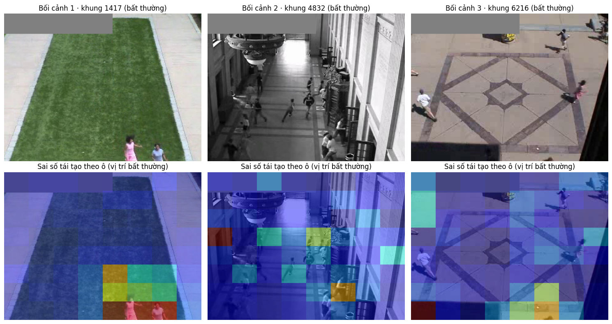

# Phát hiện hành vi đám đông bất thường trên tập UMN

## 1. Mục tiêu

Ứng dụng của đề tài theo dõi camera đám đông và cần cảnh báo khi đám đông có hành vi bất thường, ví dụ hoảng loạn bỏ chạy. Phần này trả lời hai câu hỏi:

1. Hệ thống phát hiện hoảng loạn tốt đến đâu so với các phương pháp đã công bố trên cùng tập dữ liệu?
2. **Mô hình đếm người MobileCount + Mask** (đã huấn luyện trên ShanghaiTech Part B [11]) có giúp phát hiện bất thường tốt hơn không, so với chỉ dùng chuyển động?

Bài toán được đặt theo kiểu **không giám sát**: mô hình chỉ học từ đoạn video bình thường, không thấy bất kỳ khung bất thường nào khi huấn luyện. Lý do: trên camera thật, cảnh bất thường hiếm và không thể thu thập trước.

Mã nguồn: `anomaly_umn.ipynb`, chạy trên Kaggle (GPU T4).

## 2. Dữ liệu UMN

**UMN Unusual Crowd Activity** (University of Minnesota) là tập chuẩn cho bài toán phát hiện hoảng loạn trong đám đông.

| Thuộc tính | Giá trị |
|---|---|
| Số clip | 11 |
| Số bối cảnh | 3: bãi cỏ (2 clip), trong nhà (6 clip), quảng trường (3 clip) |
| Số khung | 7.739 (1.453 / 4.143 / 2.143 theo bối cảnh) |
| Độ phân giải, tốc độ | 320×240, 30 fps |
| Tỉ lệ khung bất thường | 14,7% |

Mỗi clip bắt đầu bằng cảnh mọi người đi lại bình thường, sau đó cả đám đông đột ngột bỏ chạy khỏi khung hình.

*Hình 1. Khung bình thường và bất thường của các bối cảnh.*

**Nhãn.** Video gốc hiện dòng chữ đỏ "Abnormal Crowd Activity" ở góc trên trái trong suốt đoạn bất thường. Nhãn từng khung được đọc tự động từ dòng chữ này: khung có hơn 300 điểm ảnh màu đỏ trong 30 hàng trên cùng là bất thường. Kết quả tìm được đúng 11 đoạn bất thường, khớp với 11 clip.

**Chống lộ nhãn.** Sau khi đọc nhãn, vùng chữ (góc 176×33 điểm ảnh) bị **tô xám ở mọi khung**. Nếu không, mô hình có thể "nhìn thấy" dòng chữ thay vì nhìn hành vi.

**Tách clip và bối cảnh.** Ranh giới bối cảnh được tìm theo chênh lệch độ sáng lớn giữa hai khung liền nhau (tại khung 1453 và 5596). Ranh giới clip nằm ngay sau mỗi đoạn bất thường.

*Hình 2. Nhãn theo thời gian. Vùng đỏ là bất thường, vạch đen là ranh giới clip.*

## 3. Giao thức đánh giá

UMN không có giao thức chia train/test chính thức. Đề tài theo **Marsden và cộng sự (ICIP 2016)** [1], vì bài này mô tả rõ cách chia:
- Với mỗi bối cảnh, **200 khung đầu của mỗi clip** gộp lại làm tập train. Các khung này đều bình thường.
- **Mọi khung còn lại** là tập test.
- Mỗi bối cảnh có một mô hình riêng.
- Trong 200 khung train của mỗi clip, 20 khung cuối làm validation để chọn epoch. Tập test không thay đổi.

| Bối cảnh | Train | Validation | Test |
|---|---|---|---|
| 1. Bãi cỏ | 360 | 40 | 1.053 |
| 2. Trong nhà | 1.080 | 120 | 2.943 |
| 3. Quảng trường | 540 | 60 | 1.543 |

Tập test có 1.136 khung bất thường.

**Chỉ số**, theo cách các bài trên UMN thường báo cáo:
- **AUC theo khung, tính riêng từng bối cảnh**, và **AUC trung bình** của 3 bối cảnh. Đây là chỉ số chính.
- **AUC tổng** trên cả 3 bối cảnh. Mỗi bối cảnh có mô hình riêng nên thang điểm khác nhau. Trước khi gộp, điểm của mỗi bối cảnh được chuẩn hóa theo trung bình và độ lệch chuẩn của khung train + validation của bối cảnh đó.
- **EER** (tỉ lệ lỗi tại điểm báo nhầm bằng bỏ sót) trên cả 3 bối cảnh.
- Nhãn dùng nguyên nhãn gốc của video, không sửa tay.

## 4. Phương pháp

### 4.1. Tổng quan

Hệ thống gồm hai mô hình nối nhau:

1. **Mô hình đếm MobileCount + Mask** (1,98 triệu tham số). Với mỗi khung, mô hình cho ra:
   - bản đồ mật độ người (tổng bản đồ là số người);
   - bản đồ xác suất "có người" (mask).

   Người trong UMN rất nhỏ, nên khung được phóng lên 640×480 trước khi đưa vào mô hình.
2. **Mô hình phát hiện bất thường** học từ optical flow (Farneback) giữa hai khung liền nhau. Tùy biến thể, mô hình dùng hoặc không dùng thông tin từ mô hình đếm.

Trích đặc trưng cho 7.739 khung mất 418 giây trên GPU T4, khoảng 18,5 khung/giây, gồm cả mô hình đếm và optical flow.

### 4.2. Đặc trưng

Mỗi khung được chia thành lưới 8×8 ô.

| Nhóm | Kích thước | Nội dung | Dùng mô hình đếm |
|---|---|---|---|
| `F0` | 8×8×11 | Mỗi ô: tốc độ trung bình, histogram 8 hướng chuyển động, entropy hướng, độ đồng hướng. Tính trên toàn ảnh | Không |
| `FM` | 8×8×11 | Như `F0` nhưng mỗi điểm ảnh có trọng số theo mask người, tức chỉ xét chuyển động của người | Mask |
| `D` | 8×8×2 | Mỗi ô: số người (tổng mật độ) và tỉ lệ diện tích có người | Mật độ, mask |
| `G` | 5 | Toàn khung, trong mask người: tốc độ, entropy hướng, độ đồng hướng, tỉ lệ chuyển động ngược hướng chính, **tổng số người** | Mask, số người |

Mọi đặc trưng được chuẩn hóa z-score riêng cho từng bối cảnh, với thống kê lấy **chỉ từ khung train**. Nhờ vậy, mức "bình thường" được học riêng cho từng góc camera. Ví dụ, người ở xa đi chậm hơn trên ảnh sẽ không bị coi là bất thường.

### 4.3. Các mô hình phát hiện

| Mô hình | Cách hoạt động | Đầu vào |
|---|---|---|
| **B0: ngưỡng tốc độ** | Mốc đơn giản nhất, không học: điểm bất thường là z-score của tốc độ trung bình | `G` cột tốc độ |
| **Isolation Forest (IF)** | 300 cây quyết định ngẫu nhiên. Khung càng dễ bị tách riêng khỏi dữ liệu train thì càng bất thường | Trung bình, max và độ lệch chuẩn của từng kênh qua 64 ô; hoặc vector `G` |
| **Autoencoder (AE)** | Mạng tích chập học nén rồi dựng lại cửa sổ 16 khung liên tiếp trên lưới 8×8 (nút cổ chai 16 kênh mỗi ô). Điểm bất thường là trung bình sai số dựng lại của 3 ô sai nhiều nhất | Lưới 8×8, 16 khung |

Autoencoder được huấn luyện 80 epoch (Adam, tốc độ học 10⁻³, batch 64) và giữ epoch có loss validation thấp nhất.

Mọi điểm bất thường được làm mượt bằng trung bình trượt **nhân quả** 15 khung (0,5 giây): điểm của một khung chỉ dùng các khung đã qua. Vì vậy hệ thống chạy được theo thời gian thực.

### 4.4. Các biến thể để đo đóng góp của mô hình đếm

Với mỗi loại mô hình phát hiện, chỉ thay đổi lượng thông tin lấy từ mô hình đếm:

| Mức thông tin | Isolation Forest | Autoencoder |
|---|---|---|
| Chỉ flow, không dùng mô hình đếm | IF-flow (`F0`) | AE-flow (`F0`) |
| Flow chỉ trong mask người | IF-flow·mask (`FM`) | AE-flow·mask (`FM`) |
| Thêm mật độ người | IF-flow·mask+density (`FM`+`D`) | AE-flow·mask+density (`FM`+`D`) |
| 4 đặc trưng toàn khung, không có số người | IF-G·mask | – |
| 4 đặc trưng toàn khung + số người | IF-G·mask+count | – |

## 5. Kết quả

### 5.1. Kết quả của mọi phương pháp

| Phương pháp | AUC BC1 | AUC BC2 | AUC BC3 | AUC trung bình | AUC tổng | EER tổng |
|---|---|---|---|---|---|---|
| B0: ngưỡng tốc độ | 0,956 | 0,612 | 0,950 | 0,839 | 0,713 | 30,4% |
| IF-flow | 0,990 | 0,749 | 0,933 | 0,891 | 0,770 | 28,5% |
| IF-flow·mask | 0,991 | 0,745 | 0,938 | 0,891 | 0,780 | 26,6% |
| **IF-flow·mask+density** | 0,991 | **0,973** | 0,961 | **0,975** | **0,959** | **8,2%** |
| IF-G·mask | **0,997** | 0,819 | 0,963 | 0,926 | 0,875 | 23,3% |
| IF-G·mask+count | 0,995 | 0,901 | 0,971 | 0,956 | 0,933 | 16,0% |
| AE-flow | 0,955 | 0,841 | 0,969 | 0,922 | 0,770 | 26,6% |
| AE-flow·mask | 0,975 | 0,870 | **0,984** | 0,943 | 0,789 | 24,2% |
| AE-flow·mask+density | 0,989 | 0,890 | 0,929 | 0,936 | 0,762 | 28,1% |

*BC: bối cảnh. In đậm: tốt nhất mỗi cột.*

- **Tốt nhất là IF-flow·mask+density**: AUC trung bình 0,975, AUC tổng 0,959, EER 8,2%.
- **Bối cảnh 2 (trong nhà) khó nhất** với mọi phương pháp, giống các bài báo khác [4]. Bối cảnh này là ảnh đen trắng, quay trong nhà, người ở nhiều độ xa khác nhau và tốc độ chạy trên ảnh tăng ít (mục 5.4).
- Ngưỡng tốc độ đơn giản (B0) đã đạt khoảng 0,95 ở bối cảnh 1 và 3, nhưng chỉ 0,612 ở bối cảnh 2. Như vậy chỉ nhìn tốc độ là không đủ.

*Hình 3. Đường ROC trên cả 3 bối cảnh của các phương pháp chính.*

### 5.2. So sánh với các bài báo cùng tập dữ liệu

| Phương pháp | Năm | AUC BC1 | AUC BC2 | AUC BC3 | AUC TB | AUC tổng | Khung train |
|---|---|---|---|---|---|---|---|
| Optical flow [2] | 2009 | – | – | – | – | 0,84 | khác |
| Social Force [2] | 2009 | – | – | – | – | 0,96 | khác |
| Chaotic invariants [3] | 2010 | – | – | – | – | 0,99 | khác |
| Sparse reconstruction [5] | 2011 | 0,995 | 0,975 | 0,964 | 0,978 | – | khác |
| Matrix approximation [6] | 2012 | 0,994 | 0,971 | 0,996 | 0,987 | – | khác |
| **Holistic + GMM [1]** | 2016 | – | – | – | – | **0,929** | **200 khung đầu mỗi clip** |
| Object-centric AE [4] | 2019 | – | 0,991 | – | – | 0,996 | khác |
| AED-Net [7] | 2019 | – | – | – | – | 0,997 | 760 / 1100 / 1000 |
| Training-less [8] | 2019 | 0,988 | 0,978 | 0,984 | 0,983 | 0,982 | không train |
| Scene perception [9] | – | 0,996 | 0,962 | 0,987 | 0,982 | 0,983 | 1000 mỗi bối cảnh |
| **Đề tài: IF-flow·mask+density** | | **0,991** | **0,973** | **0,961** | **0,975** | **0,959** | **200 khung đầu mỗi clip** |

Số liệu của [2], [3], [5], [6] lấy từ Bảng 1 của [8]; các dòng khác lấy từ bài gốc.

Các bài dùng cùng chỉ số (AUC theo khung) nhưng **số khung train khác nhau**, và nhiều bài không nói rõ cách chia. Chỉ [1] dùng đúng cách chia như đề tài, nên chỉ [1] so sánh trực tiếp được; các dòng khác dùng để định vị kết quả.

- **So trực tiếp:** đề tài vượt Marsden và cộng sự [1]: AUC tổng **0,959 so với 0,929**.
- **Định vị:**
  - Vượt Optical flow (0,84) và ngang Social Force (0,96) [2].
  - Ở bối cảnh 2, khó nhất, đạt 0,973: cao hơn Scene perception [9] (0,962) và Matrix approximation [6] (0,971), xấp xỉ Sparse reconstruction [5] (0,975) và Training-less [8] (0,978).
  - AUC trung bình thấp hơn các phương pháp tốt nhất khoảng 0,01 (0,978–0,987). Các phương pháp gần mức trần (0,996–0,997 [4], [7]) dùng mạng sâu hoặc nhiều khung train hơn (ví dụ 1000 khung mỗi bối cảnh so với 400–1.200 khung của đề tài).

Lưu ý: tuy AUC thấp hơn các phương pháp tốt nhất một chút, hệ thống của đề tài **dùng lại đúng mô hình đếm có sẵn**, không cần huấn luyện mạng phát hiện riêng (Isolation Forest huấn luyện rất nhanh trên CPU), và chạy theo thời gian thực.

### 5.3. Đóng góp của mô hình đếm

Đây là câu hỏi chính của phần này. Bảng dưới là AUC trung bình 3 bối cảnh khi tăng dần thông tin lấy từ mô hình đếm:

| Mô hình phát hiện | Chỉ flow | Flow trong mask | Thêm mật độ |
|---|---|---|---|
| Isolation Forest | 0,891 | 0,891 (+0,000) | **0,975 (+0,084)** |
| Autoencoder | 0,922 | **0,943 (+0,021)** | 0,936 (+0,014) |

Thêm **số người** vào 4 đặc trưng toàn khung: AUC trung bình từ 0,926 lên **0,956 (+0,030)**; AUC tổng từ 0,875 lên 0,933.

*Hình 4. AUC từng bối cảnh khi thêm thông tin từ mô hình đếm. Đường đen là trung bình.*

Nhận xét:
- **Mô hình đếm giúp ích ở cả hai loại mô hình phát hiện.** Mọi biến thể dùng mô hình đếm đều có AUC trung bình cao hơn bản chỉ dùng flow.
- **Mật độ người đóng góp nhiều nhất.** Với Isolation Forest, AUC bối cảnh 2 tăng từ 0,749 lên 0,973, và EER tổng giảm từ 28,5% xuống 8,2%.
- **Mask người** giúp autoencoder (+0,021) nhưng gần như không đổi với Isolation Forest. Lý do: autoencoder học từng ô, nên bỏ được chuyển động nền (bóng, cây) ở từng ô có ích; còn Isolation Forest chỉ nhìn thống kê toàn khung.
- Với autoencoder, thêm mật độ giúp bối cảnh 1 và 2 nhưng làm giảm bối cảnh 3 (0,984 → 0,929). Kết quả này chưa ổn định giữa các bối cảnh.

### 5.4. Đặc trưng nào mang tín hiệu hoảng loạn

AUC của từng đặc trưng toàn khung đơn lẻ. AUC dưới 0,5 nghĩa là đặc trưng **giảm** khi hoảng loạn.

| Đặc trưng | AUC BC1 | AUC BC2 | AUC BC3 | Bình thường → bất thường (BC2) |
|---|---|---|---|---|
| Tốc độ | 0,956 | 0,612 | 0,950 | 0,216 → 0,416 |
| Entropy hướng | 0,009 | 0,304 | 0,151 | 0,833 → 0,704 |
| Độ đồng hướng | 0,880 | 0,695 | 0,830 | 0,392 → 0,551 |
| Tỉ lệ ngược chiều | 0,136 | 0,321 | 0,139 | 0,169 → 0,116 |
| **Số người** | **0,071** | **0,027** | **0,026** | **7,33 → 1,13** |

- **Số người là đặc trưng tách rõ nhất**: ở bối cảnh 2, số người trung bình giảm từ 7,3 xuống 1,1 khi đám đông bỏ chạy khỏi khung hình.
- **Entropy hướng giảm** khi hoảng loạn. Trực giác "hoảng loạn = chuyển động hỗn loạn" không đúng với UMN: khi bỏ chạy, mọi người chạy nhanh theo vài hướng chính, nên chuyển động lớn tập trung vào ít hướng. Điều này khớp với độ đồng hướng tăng và tỉ lệ ngược chiều giảm.
- Riêng ở bối cảnh 2, tốc độ tách kém (0,612). Đây là lý do các phương pháp chỉ dựa trên chuyển động đều yếu ở bối cảnh này, và thông tin số người giúp nhiều nhất ở đây.

### 5.5. Điểm bất thường theo thời gian và vị trí bất thường

*Hình 5. Điểm bất thường theo thời gian của 3 bối cảnh. Vùng đỏ: bất thường theo nhãn. Vùng xám: train và validation.*

Điểm của các phương pháp tăng vọt ở đầu mỗi đoạn bất thường. Đường của autoencoder (xanh lá) còn tăng ở nhiều đoạn bình thường sau phần train; mục 6 giải thích hiện tượng này.

*Hình 6. Sai số dựng lại theo từng ô của AE-flow·mask+density tại khung bất thường có điểm cao nhất mỗi bối cảnh. Ô đỏ là nơi chuyển động khác bình thường nhiều nhất.*

Autoencoder cho biết **bất thường xảy ra ở đâu** trong khung hình: các ô sai số cao trùng với vị trí người đang chạy. Isolation Forest trên đặc trưng toàn khung không làm được điều này.

## 6. Hạn chế

1. **Số người giảm một phần vì khung hình trống.** Trên UMN, đoạn bất thường kết thúc khi mọi người đã chạy ra khỏi khung hình. Đặc trưng số người bắt được cả giai đoạn khung trống, không chỉ lúc đang chạy. Trên camera thật, cảnh vắng người (đêm khuya, mưa) không phải bất thường. Vì vậy cần đo thêm số báo nhầm trên video thật dài ngày trước khi dùng đặc trưng này để cảnh báo.
2. **Autoencoder lệch theo thời gian.** Autoencoder chỉ học từ 200 khung đầu mỗi clip (khoảng 7 giây). Khi số người và cách đi lại thay đổi dần trong đoạn bình thường sau đó, sai số dựng lại tăng (Hình 5). Hệ quả:
   - AUC tổng của autoencoder thấp (0,76–0,79) dù AUC từng bối cảnh cao (0,92–0,94);
   - autoencoder khó đặt một ngưỡng cảnh báo cố định.

   Isolation Forest trên đặc trưng toàn khung ít bị ảnh hưởng hơn.
3. **Nhãn gốc.** Dòng chữ "Abnormal" xuất hiện chậm hơn lúc đám đông bắt đầu chạy một chút. Một bài báo cho thấy chỉ riêng bối cảnh trong nhà, AUC chênh từ 78,4% (nhãn gốc) lên 95,6% (nhãn sửa tay) [10]. Đề tài dùng nhãn gốc, nên kết quả bối cảnh 2 có thể thấp hơn thực tế.
4. **Chưa có độ trễ phát hiện.** Lần chạy đầu chọn ngưỡng cảnh báo là phân vị 99% của điểm trên khung train, và ngưỡng này không dùng được:
   - Với Isolation Forest, ngưỡng quá cao: điểm Isolation Forest bị chặn trên, vì khung nằm ngoài vùng dữ liệu train chỉ nhận điểm ngang các khung train ở rìa. Kết quả là 0/11 clip được phát hiện.
   - Với autoencoder, ngưỡng quá thấp, vì sai số trên chính khung đã train rất nhỏ. Kết quả là 36–46% khung bình thường bị báo nhầm.

    Notebook đã được sửa để đo độ trễ ở cùng mức báo nhầm 1% và 5% cho mọi phương pháp, nhưng chưa chạy lại.
5. **UMN nhỏ và chỉ có một kiểu bất thường.** UMN chỉ có 11 clip, 3 bối cảnh, người khá thưa và chỉ có hoảng loạn bỏ chạy. Kết quả chưa nói được gì về các bất thường cục bộ như đánh nhau hay ùn tắc.

## 7. Kết luận

- Kết hợp mô hình đếm **MobileCount + Mask** với **Isolation Forest** trên chuyển động trong vùng có người và mật độ người đạt **AUC trung bình 0,975** và **AUC tổng 0,959** trên UMN. Kết quả này **vượt phương pháp cùng giao thức** (Marsden và cộng sự, 0,929) và các phương pháp optical flow kinh điển, và chỉ thấp hơn các phương pháp tốt nhất khoảng 0,01.
- **Mô hình đếm giúp phát hiện bất thường tốt hơn ở cả hai loại mô hình phát hiện.** Mật độ người có đóng góp lớn nhất: +0,084 AUC trung bình với Isolation Forest, và ở bối cảnh khó nhất AUC tăng từ 0,749 lên 0,973.
- Phân tích đặc trưng cho thấy hoảng loạn trên UMN có dạng: **tốc độ tăng, hướng chuyển động tập trung, số người giảm**.
- Autoencoder có thêm khả năng chỉ ra vị trí bất thường trong khung hình, nhưng ổn định kém hơn Isolation Forest.
- Hướng tiếp theo:
  - đo độ trễ phát hiện;
  - đo tỉ lệ báo nhầm trên video thật của camera Temple Bar;
  - phân biệt "đám đông bỏ chạy" với "khung hình vắng người".

## Tài liệu tham khảo

1. M. Marsden, K. McGuinness, S. Little, N. E. O'Connor. *Holistic Features for Real-Time Crowd Behaviour Anomaly Detection.* ICIP 2016. arXiv:1606.05310.
2. R. Mehran, A. Oyama, M. Shah. *Abnormal Crowd Behavior Detection using Social Force Model.* CVPR 2009.
3. S. Wu, B. E. Moore, M. Shah. *Chaotic Invariants of Lagrangian Particle Trajectories for Anomaly Detection in Crowded Scenes.* CVPR 2010.
4. R. T. Ionescu, F. S. Khan, M.-I. Georgescu, L. Shao. *Object-centric Auto-encoders and Dummy Anomalies for Abnormal Event Detection in Video.* CVPR 2019. arXiv:1812.04960.
5. Y. Cong, J. Yuan, J. Liu. *Sparse Reconstruction Cost for Abnormal Event Detection.* CVPR 2011.
6. L. Wang, M. Dong. *Real-time Detection of Abnormal Crowd Behavior using a Matrix Approximation-based Approach.* ICIP 2012.
7. T. Wang, Z. Miao, Y. Chen, Y. Zhou, G. Shan, H. Snoussi. *AED-Net: An Abnormal Event Detection Network.* arXiv:1903.11891, 2019.
8. A. Sikdar, A. S. Chowdhury. *An Adaptive Training-less System for Anomaly Detection in Crowd Scenes.* arXiv:1906.00705, 2019.
9. X. Zhang, D. Ma, H. Yu, Y. Huang, P. Howell, B. Stevens. *Scene Perception Guided Crowd Anomaly Detection.* Bản tác giả, University of Portsmouth.
10. Patil và cộng sự. *Global Abnormal Events Detection in Crowded Scenes using Context Location and Motion-rich Spatio-temporal Volumes.* IET Image Processing, 2018.
11. Y. Zhang, D. Zhou, S. Chen, S. Gao, Y. Ma. *Single-Image Crowd Counting via Multi-Column Convolutional Neural Network.* CVPR 2016 (tập ShanghaiTech).
