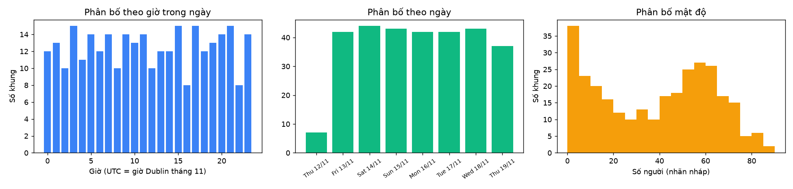
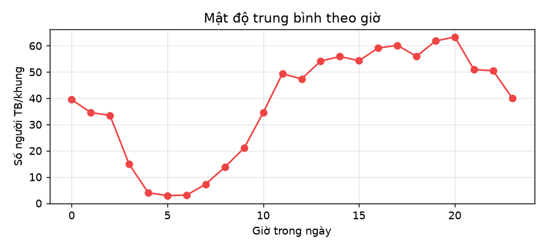
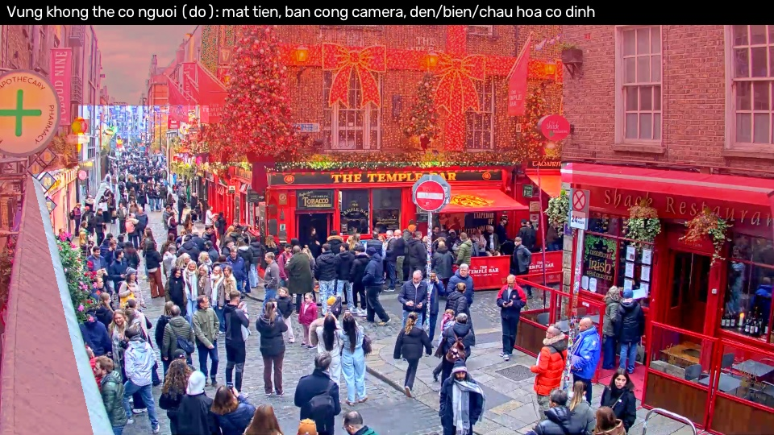
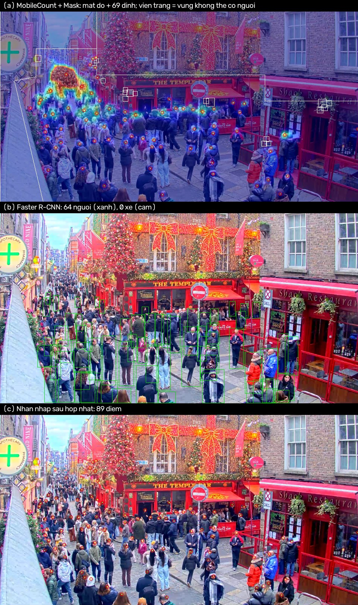
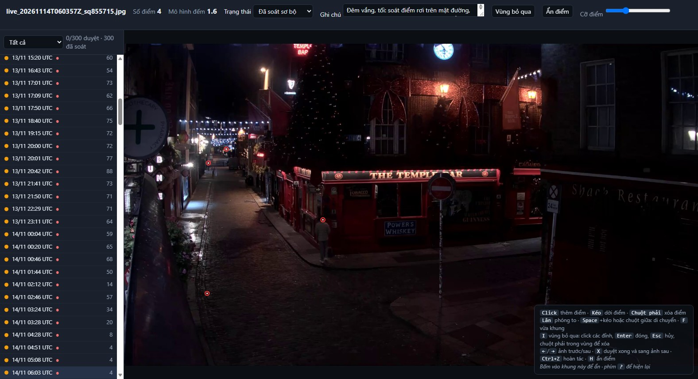

# Thu thập và gán nhãn dữ liệu camera Temple Bar (Dublin)

## 1. Mục tiêu

Mô hình MobileCount + Mask được huấn luyện trên ShanghaiTech Part B: ảnh ban ngày ở Thượng Hải, chụp từ trên cao. Camera dùng trong ứng dụng thì khác rất nhiều:
- cảnh đêm, nhiều đèn trang trí;
- video nén của livestream;
- người đứng sát camera;
- trời mưa.

Phần này xây dựng một **bộ ảnh có nhãn của chính camera này**, phục vụ hai việc:
1. Đo sai số thật của mô hình trên camera triển khai.
2. Tinh chỉnh (fine-tune) mô hình cho đúng camera.

Nhãn theo cùng định dạng với ShanghaiTech: **một điểm ở tâm đầu mỗi người**. Nhờ vậy notebook huấn luyện hiện có dùng lại được.

## 2. Nguồn dữ liệu

- **Nguồn duy nhất:** livestream công khai *EarthCam Live: Dublin, Ireland* trên YouTube. Đây chính là camera mà ứng dụng demo đang theo dõi.
- **Lấy được dữ liệu quá khứ:** YouTube cho phép tua lại livestream. Luồng DASH của livestream được chia thành các đoạn dài 5 giây, đánh số liên tiếp theo tham số `sq`. Thử nghiệm cho thấy máy chủ còn giữ khoảng **7 ngày gần nhất**, ở độ phân giải 1920×1080. Vì vậy một lần thu có thể lấy ảnh rải đều trên cả tuần, không cần ghi hình liên tục nhiều ngày.
- **Sử dụng dữ liệu:** ảnh chỉ dùng cho mục đích nghiên cứu trong đề tài và không phát tán lại. Nhãn chỉ là vị trí đầu, không nhận dạng danh tính.

## 3. Thu thập ảnh

**Công cụ:** `uv run crowd-grab` (mã ở `demo/backend/src/crowd_demo/labeling/grab.py`). Các bước:
1. Lấy địa chỉ luồng DASH H.264 1080p bằng `yt-dlp`.
2. Đọc số thứ tự đoạn mới nhất từ header `X-Head-Seqnum`.
3. Tìm nhị phân đoạn cũ nhất còn tải được. Chừa biên 30 phút ở mép cũ, vì đoạn ở đó có thể bị xóa trong lúc đang tải.
4. Chọn N đoạn **rải đều theo thời gian**, mỗi điểm chọn lệch ngẫu nhiên tối đa ±40% khoảng cách (cố định theo seed) để không lặp cùng một nhịp giờ.
5. Tải từng đoạn, lấy khung đầu tiên, lưu JPEG và ghi `manifest.csv` (tên ảnh, giờ UTC, số `sq`, nguồn, đợt thu).

**Hai đợt thu:**

| Đợt | Seed | Số ảnh | Khoảng thời gian (UTC) |
|---|---|---|---|
| 1 | 42 | 200 | 12/11 20:15 → 19/11 20:09 |
| 2 | 7 | 100 | 12/11 → 19/11 (rải lại, không trùng đợt 1) |
| **Tổng** | | **300** | **8 ngày lịch, đủ 24 giờ** |

**Độ phủ:**
- **Giờ trong ngày:** mỗi giờ có 8–15 ảnh. Tháng 11 Dublin dùng giờ GMT, nên giờ UTC cũng là giờ địa phương.
- **Ngày trong tuần:** đủ thứ Hai đến Chủ nhật, mỗi ngày 37–44 ảnh, riêng 12/11 chỉ có phần buổi tối. Từ thứ Sáu đến Chủ nhật có 129 ảnh.
- **Điều kiện ghi nhận được:** ban ngày nắng, ban ngày mưa có ô dù, chạng vạng, đêm đông người, đêm khuya vắng, đường ướt phản chiếu đèn, xe giao hàng buổi sáng, và **ống kính bị nước mưa bám** (20 ảnh, tập trung tối 16/11 đến rạng sáng 17/11 và tối 18/11).



*Hình 1. Phân bố 300 ảnh theo giờ, theo ngày, và theo số người trên ảnh (nhãn nháp).*



*Hình 2. Số người trung bình mỗi ảnh theo giờ: vắng từ 3 đến 7 giờ sáng, đông nhất vào chiều và tối.*

## 4. Quy ước gán nhãn

| Trường hợp | Cách gán |
|---|---|
| Người nhìn thấy rõ | Một điểm ở **tâm đầu** |
| Bị che một phần nhưng thấy đầu | Vẫn chấm |
| Chỉ thấy thân, đầu bị che | Chấm vào vị trí đầu ước đoán |
| Người trên poster, biển quảng cáo, hình phản chiếu trong kính | **Không chấm** |
| Người bên trong quán, nhìn qua cửa kính | Chấm nếu thấy rõ đầu |
| Đèn, biển hiệu, đồ trang trí, xe | Không chấm (mô hình học được là ở đó mật độ bằng 0) |
| Vùng quá xa hoặc quá mờ, không xác định được có người hay không (kể cả phần ống kính dính nước) | Vẽ **đa giác "vùng bỏ qua"**: không tính vào loss và không tính vào sai số khi đánh giá |

## 5. Gán nhãn nháp tự động

Gán tay từ đầu một ảnh 1080p có 40–90 người mất 5–10 phút. Vì vậy mỗi ảnh được tạo trước một **nhãn nháp tự động** từ hai mô hình bổ trợ nhau, người duyệt chỉ cần sửa.

**Công cụ:** `uv run crowd-autolabel` (`labeling/autolabel.py`). Gồm 3 bước.

### 5.1. Điểm từ bản đồ mật độ (MobileCount + Mask)

- Ảnh được đưa vào mô hình ở độ phân giải đầy đủ (rộng 1920) để tách được người ở xa.
- Số điểm K bằng tổng mật độ, làm tròn.
- Vị trí điểm là K **đỉnh cục bộ** cao nhất của bản đồ mật độ sau khi làm mượt nhẹ (Gaussian σ = 1 ô).
- **Ưu điểm:** phủ được người nhỏ ở cuối phố.
- **Nhược điểm:** hay đặt điểm nhầm lên đèn, đồ trang trí, xe. Khi người đứng sát nhau thì các đỉnh dính vào nhau nên thiếu điểm. Người to ở gần đôi khi có hai đỉnh.

### 5.2. Vùng không thể có người

Camera cố định, nên có những vùng chắc chắn không có đầu người. Các vùng này được loại khỏi bản đồ mật độ trước khi lấy điểm. Có hai loại:
1. **Vùng lớn, vẽ một lần:** mặt tiền phía trên mái hiên của quán Temple Bar và quán Shack; ban công đặt camera và dải hoa bên trái; đèn trang trí ở góc trên.
2. **Vật cố định nhỏ, tìm bằng thống kê:** đếm số ảnh có điểm nháp rơi vào cùng một ô 12×12 px.
   - Người đi qua không đứng đúng một chỗ trong hàng chục ảnh khác nhau, nên một ô xuất hiện trong rất nhiều ảnh là dấu hiệu của vật cố định.
   - Đặc biệt nếu ô đó xuất hiện cả trong **ảnh gần như vắng người**: ví dụ một đèn tường có điểm trong 35 ảnh, thì 29 ảnh trong đó gần như không có ai.
   - Mỗi ứng viên được kiểm tra trên ảnh trước khi đưa vào danh sách. Các vật cố định tìm được: đèn tường quán Temple Bar, **khuôn mặt in trên poster Guinness**, chậu hoa treo của quán Shack, quả châu trên cây thông, biển nhỏ trên tường hông quán, hình dán trên cột biển báo, đèn lồng đầu phố.
   - Các ô lặp lại nhưng nằm trên vỉa hè hoặc lòng đường (nơi người thật hay đi qua) được **giữ lại**.

Tổng cộng có 20 vùng, lưu trong `noperson.json`.



*Hình 3. Các vùng không thể có người (tô đỏ).*

### 5.3. Hợp nhất với mô hình phát hiện người

Dùng **Faster R-CNN ResNet-50 FPN v2** (huấn luyện sẵn trên COCO, có trong torchvision) để lấy khung *người* và khung *xe* (car, bus, truck) với độ tin cậy từ 0,5 trở lên. Quy tắc hợp nhất (hàm `fuse_points`, có kiểm thử):

1. **Mỗi khung người cho một điểm ở đầu:** giữa chiều ngang, cách mép trên khoảng 0,22 lần bề rộng khung. Ước lượng theo bề rộng nên vẫn đúng khi chân bị che hoặc bị cắt ở mép ảnh. Nếu gần đó (bán kính 0,45 lần bề rộng) đã có điểm mật độ thì điểm đó được **thay** bằng điểm đầu, vì vị trí từ khung người chính xác hơn. Nếu chưa có thì **thêm** điểm mới: đây là người mà bản đồ mật độ bỏ sót.
2. **Điểm mật độ còn lại bị loại** trong các trường hợp:
   - trùng với một người đã có điểm (gần đầu của khung người đó);
   - nằm trong khung người nhưng thấp hơn đầu, tức là rơi trên thân. Camera nhìn từ trên xuống, nên đầu của người đứng phía sau luôn nằm cao hơn trong ảnh;
   - nằm trong khung xe mà không thuộc khung người nào.
3. **Điểm mật độ còn lại được giữ:** chủ yếu là người nhỏ ở xa mà mô hình phát hiện không thấy.



*Hình 4. Ví dụ ảnh 14/11 lúc 14:16. (a) Bản đồ mật độ cho 69 đỉnh. (b) Faster R-CNN tìm được 64 người. (c) Sau hợp nhất còn 89 điểm: người ở gần và tầm trung được chấm đúng đầu, người ở xa giữ từ bản đồ mật độ.*

**Kết quả trên 300 ảnh:**
- Tổng **11.355 điểm nháp**.
- Trung bình 37,8 người/ảnh, trung vị 42, cao nhất 88.
- Phân bố: 61 ảnh dưới 10 người, 58 ảnh 10–29 người, 110 ảnh 30–59 người, 71 ảnh từ 60 người trở lên.
- Bước lọc vật cố định đã loại 361 điểm nhầm.

**Lỗi còn lại của nhãn nháp,** cần người duyệt sửa:
- **Thiếu người** trong cụm rất dày ở cuối phố. Ở đó tổng mật độ cao nhưng ít đỉnh tách biệt, và người quá nhỏ nên mô hình phát hiện không thấy.
- Vài điểm trên cửa kính hoặc chậu hoa quán Shack, và trên mặt đường ướt ban đêm.
- Ảnh ống kính dính nước: cả hai mô hình đều kém.

## 6. Soát sơ bộ và ghi chú

Mỗi ảnh được gắn ghi chú để người duyệt biết cần chú ý chỗ nào. Ghi chú hiện trong công cụ, và có bộ lọc "Có ghi chú".

| Ghi chú | Điều kiện | Số ảnh |
|---|---|---|
| Đông: soát kỹ người nhỏ ở cuối phố và người bị che | từ 60 điểm nháp | 71 |
| Khá đông: soát người ở cuối phố | 35–59 điểm | 97 |
| Đêm vắng, tối: soát điểm trên mặt đường, đèn, cửa kính | độ sáng trung bình < 45 và tối đa 10 điểm | 55 |
| Khung giờ giao hàng: kiểm điểm quanh xe tải, thùng hàng | 05–10 giờ | 77 |
| Ống kính dính nước mưa (nặng): vẽ vùng bỏ qua, không đưa vào tập test chính | xác định khi soát ảnh | 17 |
| Ống kính dính nước mưa (nhẹ, ở góc) | xác định khi soát ảnh | 3 |

Toàn bộ 300 nhãn nháp ở trạng thái **"Đã soát sơ bộ"**. Bản sao nhãn nháp được giữ trong `labels_draft/`, để sau khi duyệt có thể so sánh và đo lượng công việc sửa.

## 7. Công cụ chỉnh nhãn

**Công cụ:** `uv run crowd-label` rồi mở http://127.0.0.1:8010. Đây là một web nhỏ gồm FastAPI và một trang HTML/JS, không cần cài thêm gì ngoài môi trường của demo.

- Danh sách ảnh theo thời gian, có màu trạng thái (*Nháp*, *Đã soát sơ bộ*, *Người đã duyệt*), số điểm, dấu hiệu có ghi chú, bộ lọc và tiến độ.
- Thao tác: **click** để thêm điểm, **kéo** để dời, **chuột phải** để xóa. **Lăn chuột** để phóng to, **Space + kéo** để di chuyển, `F` để về vừa khung, `Ctrl+Z` để hoàn tác, `H` để ẩn điểm.
- **Vùng bỏ qua:** phím `I`, click các đỉnh, `Enter` để đóng, chuột phải bên trong vùng để xóa.
- `X` đánh dấu "Người đã duyệt" và sang ảnh tiếp theo; `←`/`→` để chuyển ảnh.
- **Tự lưu** sau mỗi thay đổi thành JSON: `points`, `ignore`, `status`, `note`, `auto_count` (số đếm của mô hình để đối chiếu).
- **Kiểm thử:**
  - 11 kiểm thử tự động cho thu thập, gán nhãn nháp, hợp nhất, API lưu nhãn (có chặn đường dẫn trái phép) và thống kê;
  - 16 thao tác được kiểm tra trên trình duyệt thật (Edge headless): thêm, kéo, xóa, hoàn tác, vẽ và xóa vùng bỏ qua, phóng to, duyệt và chuyển ảnh, ghi chú, bộ lọc. Đối chiếu với dữ liệu đã lưu thì đều đạt.



*Hình 5. Giao diện công cụ chỉnh nhãn.*

## 8. Duyệt thủ công

> *Phần này điền sau khi duyệt xong.*

- **Người duyệt:** [tên] · **Thời gian:** [ngày] · **Tổng thời gian:** [… giờ], trung bình [… phút/ảnh].
- **Quy trình:** mở từng ảnh, đọc ghi chú, rồi sửa điểm (thêm người bị thiếu, xóa điểm nhầm, dời điểm lệch), vẽ vùng bỏ qua nếu cần, cuối cùng nhấn `X`.
- **Kiểm tra chéo:** hai thành viên cùng duyệt độc lập [10] ảnh. Lệch số đếm trung bình [… người, …%]. Mức lệch này là sai số của chính người gán nhãn, tức là giới hạn dưới của MAE có thể kỳ vọng.
- **Mức độ phải sửa so với nháp** (chạy `uv run crowd-label-stats`):

| Chỉ số | Giá trị |
|---|---|
| Số ảnh đã duyệt | [ ] |
| Tổng điểm nháp → tổng điểm cuối | [ ] → [ ] |
| Giữ nguyên / dời / xóa / thêm | [ ] / [ ] / [ ] / [ ] |
| Tỉ lệ điểm nháp được giữ | [ ] |
| Sai lệch số đếm nháp so với nhãn cuối (MAE theo ảnh) | [ ] |

## 9. Định dạng và chia tập

```
demo/data/labels/dublin_live/
  frames/          300 ảnh JPEG 1920×1080, tên live_<giờ UTC>_sq<số đoạn>.jpg
  labels/          nhãn cuối, mỗi ảnh một JSON {points, ignore, status, note, auto_count}
  labels_draft/    nhãn nháp tự động (để so sánh)
  manifest.csv     tên ảnh, giờ UTC, sq, nguồn, đợt thu
  noperson.json    các vùng không thể có người
```

**Chia theo ngày, không chia ngẫu nhiên,** vì các ảnh gần nhau về thời gian rất giống nhau. Đề xuất:

| Tập | Ngày | Số ảnh |
|---|---|---|
| Train | 12/11 → 16/11 (có cả cuối tuần) | khoảng 178 |
| Validation | 17/11 | khoảng 42 |
| Test | 18/11 → 19/11 | khoảng 80 |

- Ảnh ống kính dính nước mưa nặng **không đưa vào tập test chính**. Có thể báo cáo riêng thành tập "điều kiện xấu".
- Khi huấn luyện, điểm được chuyển thành bản đồ mật độ Gaussian σ = 15 px giống ShanghaiTech Part B. Mask vùng có người được tạo tự động từ bản đồ mật độ, và vùng bỏ qua được nhân 0 vào loss.

## 10. Hạn chế

- Chỉ một camera, trong 8 ngày của tháng 11 (mùa Giáng sinh, nhiều đèn trang trí). Chưa có các mùa khác hoặc sự kiện rất đông như lễ St. Patrick.
- YouTube chỉ giữ khoảng 7 ngày. Muốn mở rộng thì phải chạy `crowd-grab` định kỳ, mỗi tuần một lần.
- Nhãn nháp chịu ảnh hưởng của mô hình tạo ra nó. Người duyệt có thể bị "kéo" theo lỗi của nháp, nhất là ở vùng xa. Vì vậy tập test cần được soát kỹ nhất.
- Giờ của mỗi ảnh được tính từ số thứ tự đoạn (5 giây/đoạn), nên có thể lệch vài phút nếu livestream từng bị gián đoạn.
