# Hệ thống đếm người và phát hiện đám đông bất thường phục vụ an ninh nơi công cộng

*Báo cáo đề tài môn An toàn thông tin*

---

## Tóm tắt

Đề tài xây dựng hệ thống giám sát đám đông từ camera công cộng. Hệ thống ước lượng số người, khoanh vùng nơi đám đông tập trung, theo dõi chuyển động và cảnh báo khi có dấu hiệu bất thường. Kết quả chính:

- **Mô hình đếm người MobileCount + Mask:** cải tiến MobileCount bằng một nhánh dự đoán vùng có người.
  - Trên ShanghaiTech Part B, trung bình 3 lần huấn luyện (seed 42, 43, 44), checkpoint chọn theo val: **MAE 9,69 ± 0,87 / MSE 16,04 ± 2,11**, so với baseline MobileCount tự huấn luyện 9,78 ± 0,38 / 15,95 ± 0,32.
  - Với checkpoint epoch cuối, MAE **8,91 ± 0,11** so với 9,37 ± 0,12 của baseline; cả 3 seed đều tốt hơn baseline.
  - **Đếm nhầm ở nền giảm 46%** (2,44 → 1,31 người/ảnh).
  - Có thêm bản đồ khoanh vùng đám đông, IoU 0,88.
  - Mô hình chỉ có 1,98 triệu tham số. Độ chính xác cao hơn kết quả của MCNN và CSRNet khi huấn luyện trong cùng điều kiện.
  - Checkpoint tốt nhất của mỗi cách được đưa vào demo: MobileCount + Mask MAE 8,49 / MSE 13,77; baseline 9,30 / 15,47.
- **Hệ thống ứng dụng chạy trên CPU:**
  - Phát video hoặc livestream YouTube ở 25–28 FPS; phân tích 1,5 lần mỗi giây.
  - Vùng giám sát và vùng loại trừ vẽ trực tiếp trên web.
  - Optical flow Farneback cho phân tích chuyển động.
  - Chọn model baseline hoặc MobileCount + Mask ngay trên web để so sánh.
  - Năm luật cảnh báo, ngưỡng tự học từ dữ liệu bình thường của từng camera, có mức sàn, thời gian duy trì và thời gian nghỉ để hạn chế báo nhầm.
  - Lưu trữ SQLite, kèm ảnh và clip bằng chứng cho mỗi cảnh báo.

---

## 1. Đặt vấn đề

### 1.1. Bối cảnh

Ở ga tàu, quảng trường, phố đi bộ hay sự kiện đông người, các sự cố nghiêm trọng như chen lấn, giẫm đạp hay hoảng loạn thường bắt đầu bằng những dấu hiệu đo được: mật độ tăng quá nhanh, người dồn về một điểm, hoặc dòng người đột ngột chạy tán loạn. Một người giám sát khó theo dõi liên tục nhiều màn hình. Hệ thống tự động ước lượng mật độ và phát hiện sớm các dấu hiệu này giúp lực lượng an ninh có thêm thời gian phản ứng.

### 1.2. Vì sao không dùng phát hiện đối tượng

Cách trực quan nhất là dùng một mô hình phát hiện đối tượng (như YOLO) để đóng khung từng người rồi đếm. Ở đám đông dày, cách này gặp nhiều khó khăn:
- Đầu người rất nhỏ, chỉ vài chục pixel.
- Người che khuất nhau, chỉ lộ một phần đầu.
- Số đối tượng trong một khung hình lên tới hàng trăm.

Hậu quả là mô hình phát hiện bỏ sót nặng đúng ở những cảnh cần cảnh báo nhất. Hướng **ước lượng mật độ** (density estimation) không cần tách rời từng người. Mô hình dự đoán một bản đồ mật độ, số người là tổng của bản đồ đó, nên hoạt động tốt ở cảnh đông.

### 1.3. Mục tiêu và phạm vi

- Huấn luyện và cải tiến một mô hình đếm người nhẹ, đủ nhanh để chạy trên CPU; so sánh với các baseline MCNN, CSRNet, MobileCount.
- Khoanh vùng đám đông; cho phép chọn vùng cần giám sát và vùng loại trừ.
- Phát hiện bất thường dựa trên mật độ và chuyển động, có bằng chứng cho mỗi cảnh báo.
- Đối tượng là **người đi bộ** trong cảnh đường phố.
- Camera demo dự kiến là livestream phố Shinsaibashi (Osaka). Trong thời gian chưa lấy được luồng của camera này, hệ thống được chạy thử trên livestream EarthCam ở khu Temple Bar (Dublin), cũng là phố đi bộ đông người.

---

## 2. Tổng quan và lựa chọn hướng tiếp cận

### 2.1. Ba hướng đếm người

| Hướng | Mô hình trả ra | Ưu điểm | Nhược điểm |
|---|---|---|---|
| Phát hiện rồi đếm | Khung bao từng người | Biết vị trí từng người | Bỏ sót nhiều ở cảnh đông, bị che khuất |
| Hồi quy số đếm | Một con số | Đơn giản | Không biết người ở đâu |
| **Ước lượng mật độ** | Bản đồ mật độ; số người = tổng | Tốt ở cảnh đông; biết vùng đông | Không tách được từng cá thể |

Đề tài chọn **ước lượng mật độ**. Bản đồ mật độ cho cùng lúc hai thông tin: số người, và vị trí đám đông trên khung hình. Thông tin vị trí là cơ sở cho các tính năng vùng giám sát, vùng loại trừ và khoanh vùng đám đông.

**Nhãn mật độ.** Bộ dữ liệu chỉ gán một điểm tại đầu mỗi người. Mỗi điểm được rải thành một vệt Gaussian có tổng bằng 1; cộng các vệt lại được bản đồ mật độ có tổng đúng bằng số người.

### 2.2. Các mô hình mật độ

| Mô hình | Ý tưởng | Kích thước |
|---|---|---|
| MCNN (CVPR 2016) | Ba nhánh CNN với kernel khác nhau cho đầu người to và nhỏ | 0,13 triệu tham số |
| CSRNet (CVPR 2018) | VGG-16 + các lớp tích chập giãn (dilated) để mở rộng vùng nhìn | 16,26 triệu tham số |
| **MobileCount** (Neurocomputing 2020) | Encoder MobileNetV2 + decoder Light-Weight RefineNet | khoảng 2 triệu tham số |

**MobileCount** được chọn làm nền vì cân bằng tốt nhất giữa độ chính xác và tốc độ. Mô hình nhẹ hơn CSRNet khoảng 8 lần, đủ nhanh để chạy trên CPU, trong khi kết quả công bố trên ShanghaiTech Part B (MAE 9,0) còn tốt hơn CSRNet (10,6).

### 2.3. Các dấu hiệu bất thường

| Nhóm | Dấu hiệu | Nguồn thông tin |
|---|---|---|
| Mật độ | Quá đông so với sức chứa; một chỗ quá dày; số người tăng đột ngột | Bản đồ mật độ |
| Chuyển động | Chạy tán loạn (nhanh và nhiều hướng); dòng người ngược chiều | Optical flow |

---

## 3. Phương pháp đề xuất

### 3.1. Tổng thể hệ thống

```
Camera / video
   │
   ▼
Đọc frame (FPS gốc) ─────────────────────────────► Hiển thị + lớp nhận diện
   │ frame mới nhất
   ▼
MobileCount + Mask ──► bản đồ mật độ D, mask vùng có người M
   │
   ├─► Phân tích không gian: vùng giám sát, vùng loại trừ, ô lưới ─► số người, ô đông
   ├─► Optical flow Farneback (chỉ trên vùng có người) ─► tốc độ, hướng, hỗn loạn, ngược chiều
   ▼
Học mức bình thường + 5 luật ─► cảnh báo ─► ảnh + clip bằng chứng ─► SQLite ─► Dashboard
```

### 3.2. Mô hình MobileCount + Mask

**Kiến trúc.**
- Encoder MobileNetV2 (pretrained ImageNet) lấy đặc trưng ở bốn mức 1/4, 1/8, 1/16 và 1/32.
- Decoder Light-Weight RefineNet: các khối CRP (chuỗi max pool 5×5 và conv 1×1) gộp dần từ mức sâu lên mức nông, cho ra đặc trưng Y ở độ phân giải 1/4.
- Từ Y có hai nhánh:

```
Y ─┬─► head mật độ ─► D
   └─► head mask   ─► M = sigmoid(·)          Đầu ra = D × M
```

**Nhánh mask:**
- Gồm 2 lớp conv nhỏ, khoảng 0,02 triệu tham số, dự đoán xác suất mỗi ô 4×4 pixel thuộc vùng có người.
- Đầu ra cuối là D × M. Ở nền như mặt đường, cửa kính hay biển hiệu, M gần 0 nên mật độ "rò rỉ" ở đó bị triệt tiêu.
- **Nhãn mask tạo tự động** từ bản đồ mật độ ground truth: ô nào có mật độ lớn hơn 0 (tức nằm trong bán kính 3σ của một đầu người) là "có người". Vì vậy không cần gán nhãn thêm.
- Khi triển khai, M cắt ngưỡng 0,5 chính là **bản đồ khoanh vùng đám đông**.

**Hàm mất mát:**

L = MSE(D × M, mật độ ground truth) + 0,1 × BCE(M, nhãn vùng có người)

Phần BCE buộc encoder học đặc trưng phân biệt người với nền, nên cũng có lợi cho nhánh mật độ.

Ý tưởng dùng phân đoạn hoặc mask hỗ trợ đếm đã có trong *Counting with Focus for Free* (ICCV 2019) và SFANet. Đóng góp của đề tài là gắn nhánh này vào một mô hình nhẹ chạy thời gian thực, và đo được tác dụng của nó trong cùng quy trình huấn luyện với baseline.

### 3.3. Phân tích không gian

- **Vùng giám sát (ROI)** và **vùng loại trừ** là các đa giác với tọa độ chuẩn hóa 0–1, không phụ thuộc độ phân giải. Người vận hành vẽ trực tiếp trên khung hình.
- **Số người được giám sát** = tổng mật độ trong ROI, trừ phần nằm trong vùng loại trừ. Vùng loại trừ dùng để bỏ qua khu vực không cần theo dõi, và những vật mô hình hay nhầm là người, như đèn trang trí, màn hình, poster.
- **Khoanh vùng đám đông:**
  - Đường bao của mask M cho biết đám đông nằm ở đâu.
  - Thêm một lưới ô 64×64 pixel: cộng mật độ trong từng ô, ô vượt ngưỡng được đánh dấu là nơi người tụ dày.

### 3.4. Phân tích chuyển động bằng optical flow Farneback

Farneback là thuật toán optical flow cổ điển có sẵn trong OpenCV, **không cần mô hình học sâu**. Thuật toán xấp xỉ vùng quanh mỗi điểm ảnh bằng đa thức bậc hai rồi so giữa hai frame, cho ra một vector dịch chuyển (dx, dy) tại mỗi điểm.

- Flow được tính giữa frame hiện tại và frame khoảng 0,2 giây trước, trên ảnh xám rộng 320 px. Như vậy đủ nhẹ để chạy song song với mô hình trên CPU.
- **Chỉ giữ các điểm hợp lệ:** nằm trong vùng giám sát, thuộc vùng có người (M > 0,5), và dịch chuyển ít nhất 0,5 px. Nhờ đó đèn nhấp nháy hay xe chạy qua không bị tính là đám đông chuyển động.
- Bốn đặc trưng:
  - **Tốc độ:** độ dài vector trung bình chia cho thời gian giữa hai frame.
  - **Hướng chính:** hướng của tổng các vector.
  - **Mức hỗn loạn:** entropy của histogram 16 hướng (có trọng số theo độ dài vector), chuẩn hóa về 0–1. Bằng 0 khi mọi người đi cùng hướng, gần 1 khi hướng trải đều ra mọi phía.
  - **Tỉ lệ ngược chiều:** phần chuyển động lệch hơn 120° so với hướng chính.

### 3.5. Luật phát hiện bất thường

**Học mức bình thường.** Mỗi camera có mật độ và nhịp di chuyển riêng, nên ngưỡng được học từ chính camera đó. Trong 5 phút đầu, hoặc khi người vận hành bấm "Học mức bình thường", hệ thống ghi lại các đại lượng rồi lấy trung vị *m* và độ lệch bền σ = 1,4826 × MAD. Dùng trung vị và MAD thay cho trung bình và độ lệch chuẩn để ngưỡng ít bị ảnh hưởng bởi vài lần đếm sai. Sau đó mức nền được tính lại mỗi 30 s theo 15 phút gần nhất, để theo kịp nhịp phố thay đổi trong ngày; giới hạn cứng cho đám đông tích tụ chậm là sức chứa tối đa do người vận hành đặt.

| Luật | Điều kiện kích hoạt |
|---|---|
| Quá đông | số người > *m* + max(3σ; 30%·*m*; 5 người), hoặc > sức chứa tối đa do người vận hành đặt |
| Ô quá dày | ô đông nhất > max(4; 1,3 × phân vị 95 của lúc bình thường) |
| Tăng đột ngột | số người hiện tại − trung vị của 20–60 s trước > max(10 người; 50%) |
| Hỗn loạn | tốc độ > *m* + 4·max(σ; 10%·*m*; 0,5) **và** mức hỗn loạn > *m* + 4·max(σ; 0,02) |
| Ngược chiều | tỉ lệ ngược chiều > max(30%; *m* + 4·max(σ; 0,05)) |

**Chống báo nhầm:**
- Số người được làm mượt bằng trung vị 3 mẫu.
- Mỗi ngưỡng có mức sàn (5 người, 4 người/ô, 30% ngược chiều), để lúc phố vắng σ ≈ 0 không kéo ngưỡng sát mức hiện tại.
- Mỗi luật phải đúng **liên tục 6 giây** mới cảnh báo, mỗi đợt chỉ báo một lần, và hai cảnh báo cùng loại cách nhau ít nhất **60 giây**.
- Luật hỗn loạn đòi **đồng thời** tốc độ cao và hướng phân tán. Nhờ vậy một người chạy qua, hay cả đám đông cùng rảo bước theo một hướng, đều không bị báo.

---

## 4. Thực nghiệm mô hình đếm người

### 4.1. Dữ liệu ShanghaiTech Part B

Part B gồm ảnh đường phố Thượng Hải kích thước 1024×768, mật độ vừa phải, gần với cảnh camera giám sát phố đi bộ. 10% ảnh huấn luyện được tách ra làm tập validation để chọn checkpoint. Tập test chỉ dùng để báo cáo kết quả.

| Tập | Số ảnh | Tổng số người | Ít nhất | Nhiều nhất | Trung bình | Trung vị | Độ lệch chuẩn |
|---|---|---|---|---|---|---|---|
| Train | 360 | 44.242 | 12 | 576 | 122,9 | 101,5 | 93,9 |
| Validation | 40 | 4.909 | 23 | 412 | 122,7 | 94,0 | 92,3 |
| Test | 316 | 39.121 | 9 | 539 | 123,8 | 93,0 | 95,1 |

- Mọi ảnh cùng kích thước 1024×768.
- Phân bố số người lệch phải: phần lớn ảnh có 50–200 người, một số ít trên 400 người.
- Vùng "có người" (trong bán kính 3σ của một đầu người) chiếm trung bình 34,5% diện tích ảnh test; phần còn lại là nền, nơi mật độ ground truth bằng 0.
- Nhãn mật độ dùng Gaussian σ = 15 px, tổng mật độ khớp số nhãn với sai lệch dưới 0,001 người.

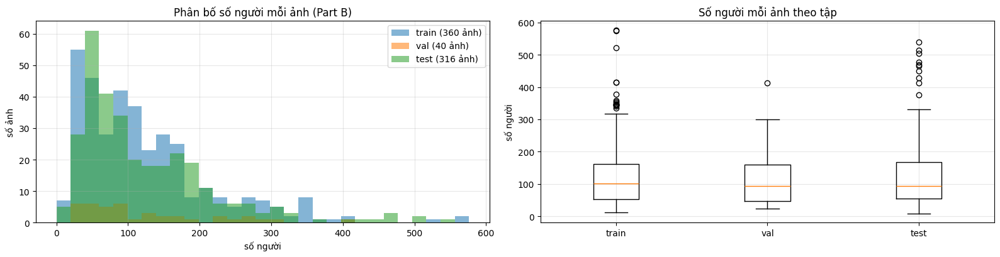

*Hình 4.1. Phân bố số người mỗi ảnh. Ba tập có phân bố gần nhau (trung vị 93–102 người), lệch phải, với vài ảnh trên 400 người.*

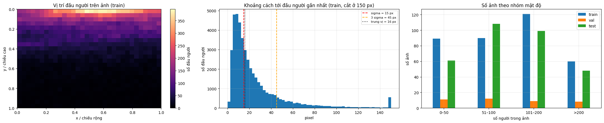

*Hình 4.2. Trái: đầu người tập trung ở phần trên ảnh (xa camera), nơi đầu nhỏ và dày đặc; phần dưới gần như trống. Giữa: khoảng cách tới đầu người gần nhất có trung vị 16 px, xấp xỉ σ = 15 px của Gaussian, nên các Gaussian chồng lên nhau ở vùng đông; bán kính 3σ = 45 px dùng để định nghĩa vùng "có người" bao phần lớn các khoảng cách này. Phải: số ảnh theo nhóm mật độ; tập validation chỉ có 8–12 ảnh mỗi nhóm, nên val MAE rất nhiễu (mục 4.6).*

### 4.2. Thiết lập huấn luyện và đánh giá

Mọi mô hình dùng **cùng một quy trình**:

| Hạng mục | Giá trị |
|---|---|
| Tối ưu | Adam, learning rate 1e-4 giảm theo cosine xuống 1e-6, weight decay 1e-4 |
| Số epoch | 400, không dừng sớm |
| Dữ liệu train | Patch 512×512 cắt ngẫu nhiên, lật ngang 50%, batch 8 |
| Checkpoint | Lưu cả checkpoint có val MAE thấp nhất (đo mỗi 5 epoch) và checkpoint epoch cuối |
| Phần cứng | GPU Tesla T4 (Kaggle), mixed precision |
| Seed | Baseline và MobileCount + Mask: 3 seed (42, 43, 44), báo cáo trung bình ± độ lệch chuẩn. Ablation (mục 4.4): 1 seed (42) |
| Thời gian | Khoảng 48 phút mỗi lần huấn luyện |

Các chỉ số trên toàn bộ 316 ảnh test, ở kích thước gốc:
- **MAE và MSE:** theo quy ước của lĩnh vực, MSE thực chất là căn bậc hai sai số bình phương trung bình.
- **GAME(L):** chia ảnh thành 4^L ô và cộng sai số đếm từng ô, đo cả việc đếm đúng chỗ.
- **Đếm nhầm ở nền:** tổng mật độ dự đoán rơi vào chỗ cách mọi đầu người hơn 3σ.
- **IoU mask:** độ trùng giữa vùng đám đông dự đoán và thực tế.

### 4.3. So sánh với các baseline

| Mô hình | Tham số (triệu) | MAE | MSE | MAE epoch cuối | Số công bố (MAE / MSE) |
|---|---|---|---|---|---|
| MCNN | 0,13 | 36,59 | 59,34 | – | 26,4 / 41,3 |
| CSRNet | 16,26 | 10,43 | 16,07 | – | 10,6 / 16,0 |
| MobileCount (baseline) | 1,96 | 9,78 ± 0,38 | 15,95 ± 0,32 | 9,37 ± 0,12 | 9,0 / 15,4 |
| **MobileCount + Mask (đề xuất)** | **1,98** | **9,69 ± 0,87** | 16,04 ± 2,11 | **8,91 ± 0,11** | – |

- Kết quả MCNN và CSRNet lấy từ notebook huấn luyện riêng cho từng mô hình (1 lần huấn luyện).
- MobileCount và MobileCount + Mask lấy từ bảng cuối của notebook `final_mobilecount` (bản đã chạy: `final-mobilecount-tr-n-shanghaitech.ipynb`): trung bình ± độ lệch chuẩn của 3 seed. Cột MAE và MSE dùng checkpoint có val MAE thấp nhất; cột "MAE epoch cuối" dùng checkpoint ở epoch 400.
- CSRNet tái lập sát kết quả công bố (lệch 0,17 MAE). MCNN kém hơn công bố khoảng 10 MAE. Nhiều khả năng nguyên nhân là bản tái hiện huấn luyện cả mạng cùng lúc từ đầu, trong khi bài gốc tiền huấn luyện từng nhánh riêng.
- Hai biến thể MobileCount đều có MAE thấp hơn CSRNet trong khi nhỏ hơn khoảng 8 lần. Theo checkpoint chọn bằng val, MobileCount + Mask ngang baseline (MAE 9,69 so với 9,78; MSE 16,04 so với 15,95). Theo checkpoint epoch cuối, Mask tốt hơn rõ (8,91 so với 9,37) và thấp hơn cả số công bố của MobileCount gốc (9,0).

**So sánh chi tiết baseline và MobileCount + Mask** (trung bình ± độ lệch chuẩn của 3 seed; bảng `results/final_comparison_partB.csv`):

| Chỉ số | MobileCount (baseline) | MobileCount + Mask |
|---|---|---|
| MAE, checkpoint epoch cuối | 9,37 ± 0,12 | **8,91 ± 0,11** |
| MAE, checkpoint theo val | 9,78 ± 0,38 | 9,69 ± 0,87 |
| MSE, checkpoint theo val | 15,95 ± 0,32 | 16,04 ± 2,11 |
| GAME1 / GAME2 / GAME3 (theo val) | 13,04 / 17,63 / 23,86 | **12,78 / 17,17 / 23,01** |
| Đếm nhầm ở nền (theo val, người/ảnh) | 2,44 ± 0,30 | **1,31 ± 0,13** |
| IoU mask | – | 0,88 |
| Tham số / GMACs | 1,96 triệu / 7,47 | 1,98 triệu / 8,37 |
| FPS fp32 / fp16 (T4, ảnh 1024×768) | 50,1 / 72,4 | 48,5 / 79,5 |

- **Checkpoint epoch cuối:** Mask tốt hơn baseline ở **cả 3 seed**. MAE giảm 0,46, gấp khoảng 4 lần độ lệch chuẩn; hai khoảng giá trị không chồng nhau (baseline 9,30–9,51, Mask 8,81–9,03).
- **Checkpoint theo val:** hai mô hình ngang nhau về MAE và dao động lớn, ví dụ Mask seed 42 có MAE 10,68 vì checkpoint được chọn ở epoch 215. Nguyên nhân là tập val 40 ảnh quá nhiễu để chọn checkpoint (mục 4.6), không phải do mô hình.
- **Đếm nhầm ở nền giảm 46%** và ổn định ở cả 3 seed (1,20–1,45 so với 2,10–2,66).
- **Chi phí:** thêm 0,02 triệu tham số và khoảng 12% phép tính; tốc độ thực tế tương đương.

**Checkpoint dùng trong demo.** Với mỗi cách, demo dùng checkpoint có MAE test thấp nhất trong các lần huấn luyện cùng cấu hình:

| Cách | File trong demo | Lần huấn luyện | MAE | MSE |
|---|---|---|---|---|
| MobileCount (baseline) | `demo/models/baseline.pth` | epoch cuối, seed 42, notebook `final_mobilecount` | 9,30 | 15,47 |
| MobileCount + Mask | `demo/models/mask.pth` | epoch cuối, seed 42, notebook ablation (C1) | 8,49 | 13,77 |

Vì được chọn theo tập test, hai con số này lạc quan hơn kết quả kỳ vọng. Con số dùng để so sánh hai cách là trung bình 3 seed ở bảng trên.

### 4.4. Ablation các hướng cải tiến

Mỗi phiên bản là baseline cộng **đúng một** thay đổi, để thấy tác dụng riêng của từng cải tiến.

| Phiên bản | MAE | MSE | GAME1 | GAME2 | GAME3 | Đếm nhầm ở nền | IoU mask | MAE epoch cuối | Tham số (triệu) | FPS fp32 / fp16 (T4) |
|---|---|---|---|---|---|---|---|---|---|---|
| Baseline MobileCount | 9,35 | 15,43 | 12,69 | 17,14 | 23,46 | 2,27 | – | 9,35 | 1,96 | 47,9 / 71,0 |
| **C1: nhánh mask** | **8,88** | **14,24** | **12,01** | **16,63** | **22,45** | **1,19** | **0,88** | **8,49** | 1,98 | 47,7 / 77,5 |
| C2: ASPP (ngữ cảnh đa tỉ lệ) | 9,87 | 15,78 | 12,84 | 17,31 | 23,55 | 2,29 | – | 9,82 | 2,36 | 48,5 / 79,1 |
| C5: augmentation cho camera thật | 9,88 | 15,94 | 13,45 | 18,43 | 24,74 | 2,30 | – | 9,33 | 1,96 | 49,8 / 80,3 |
| C1 + C5 | 9,44 | 16,47 | 12,54 | 17,16 | 23,16 | 1,49 | 0,87 | 8,85 | 1,98 | 47,2 / 77,3 |

FPS đo với ảnh 1024×768, batch 1. Chênh lệch FPS fp16 của baseline so với các phiên bản khác nhiều khả năng do thứ tự đo (baseline được đo đầu tiên), không phải do kiến trúc. Các phiên bản cùng encoder có tốc độ tương đương.

**Nhận xét từng hướng:**
- **C1 (nhánh mask):** tốt hơn baseline ở **mọi** chỉ số.
  - MAE −0,47, MSE −1,19, GAME3 −1,01.
  - Đếm nhầm ở nền giảm 48%, và giảm đều ở cả bốn nhóm mật độ (bảng 4.5).
  - Có thêm bản đồ khoanh vùng (IoU 0,88) gần như không tốn chi phí.
  - Đây là phiên bản được chọn.
- **C2 (ASPP)** và **C5 (augmentation: đổi tỉ lệ, sáng tối, mờ, nén JPEG, ảnh xám)** không cải thiện trên ShanghaiTech. C5 được thiết kế cho ảnh camera thật (ban đêm, ảnh nén), mà tập test ShanghaiTech không có những điều kiện đó, nên chưa đo được tác dụng.
- **C1 + C5:** không cộng dồn được tác dụng. Kết quả kém C1 riêng lẻ về MAE và MSE, chỉ đếm thừa ít hơn ở ảnh có 51–200 người.
- **C6 (encoder MobileNetV3-Large),** thử ở vòng trước với lịch learning rate khác:
  - Kém hơn baseline cùng vòng: MAE 10,85 so với 10,32; đếm nhầm ở nền 4,43 so với 2,64.
  - Kém rõ ở ảnh trên 200 người (MAE 28,7 so với 24,0).
  - Vì vậy đã loại. Encoder mới hơn không có nghĩa là tốt hơn cho bài toán đếm người.

Bảng ablation chỉ có 1 seed. Kết quả 3 seed ở mục 4.3 xác nhận hướng C1: MAE epoch cuối giảm 0,46 ở cả 3 seed và đếm nhầm ở nền giảm 46%. Ở vòng thử trước (quy trình khác), C1 cũng giảm đếm nhầm ở nền 39% (2,64 → 1,60).

C1 trong ablation và MobileCount + Mask ở mục 4.3 có cùng cấu hình và cùng seed 42, nhưng kết quả khác nhau (MAE epoch cuối 8,49 so với 8,87). Nguyên nhân là tính toán trên GPU không hoàn toàn tất định. Đây thêm một lý do để kết luận dựa trên nhiều seed thay vì một lần huấn luyện.

### 4.5. Phân tích lỗi theo mật độ

MAE và độ lệch trung bình (dương là đếm thừa) theo số người thật trong ảnh test. Mỗi ô là trung bình của 3 seed, checkpoint theo val:

| Nhóm mật độ | Số ảnh | MAE baseline | MAE + Mask | Lệch TB baseline | Lệch TB + Mask | Đếm nhầm ở nền baseline | Đếm nhầm ở nền + Mask |
|---|---|---|---|---|---|---|---|
| 0–50 người | 61 | 2,57 | 2,37 | +0,54 | −0,10 | 2,46 | 1,17 |
| 51–100 | 108 | 5,84 | 5,63 | +2,15 | +1,78 | 2,75 | 1,60 |
| 101–200 | 99 | 12,10 | 11,92 | +5,13 | +4,73 | 2,37 | 1,26 |
| > 200 | 48 | 23,03 | 23,54 | +3,29 | +5,07 | 1,85 | 0,92 |

- Sai số tuyệt đối tăng theo mật độ, như mọi mô hình đếm người. Tính theo tỉ lệ thì ổn định, khoảng 8% số người ở mọi nhóm.
- Nhánh mask giảm nhẹ MAE ở ba nhóm dưới 200 người (khoảng 0,2) và kém nhẹ ở nhóm trên 200 người (+0,5).
- **Đếm nhầm ở nền giảm 42–52% ở mọi nhóm**: đây là tác dụng rõ và ổn định nhất của nhánh mask.
- Ví dụ rõ nhất: ảnh IMG_17 (71 người). Baseline seed 42 dự đoán 102,5 người, trong đó 34,8 người rơi vào nền; MobileCount + Mask cùng seed dự đoán 76,8 người, chỉ 1,6 người ở nền.
- Cả hai mô hình vẫn đếm thừa ở nhóm 51–200 người (+1,8 đến +5,1). Đây là điểm cần cải thiện tiếp.

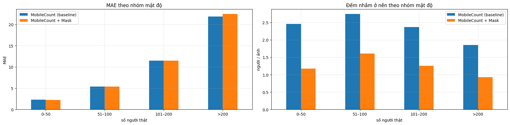

*Hình 4.3. MAE (trái) và đếm nhầm ở nền (phải) theo nhóm mật độ. Hình lấy trung bình dự đoán của 3 seed cho từng ảnh rồi mới tính MAE, nên cột MAE thấp hơn MAE trung bình từng seed trong bảng. Cột phải cho thấy đếm nhầm ở nền giảm khoảng một nửa ở mọi nhóm.*

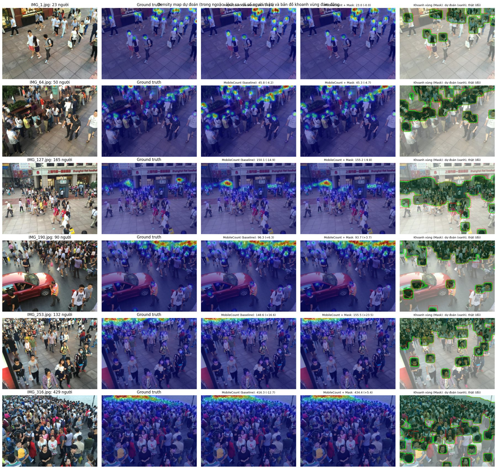

*Hình 4.4. Sáu ảnh test. Từ trái sang: ảnh gốc; density map ground truth; dự đoán của baseline; dự đoán của MobileCount + Mask (trong ngoặc là độ lệch so với số người thật); khoanh vùng đám đông của nhánh mask, xanh lá là dự đoán, đỏ là thật. Vùng dự đoán bám sát vùng thật (IoU 0,88), kể cả quanh những người đứng lẻ; chiếc xe đỏ ở IMG_190 không bị khoanh.*

### 4.6. Bài học về quy trình huấn luyện

Quá trình thực nghiệm cho thấy cách huấn luyện ảnh hưởng tới kết quả ngang với một cải tiến kiến trúc:

| Quy trình (baseline MobileCount) | MAE test |
|---|---|
| Learning rate cố định, bị ngắt do giới hạn thời gian | 11,68 |
| Giảm learning rate khi val chững lại + dừng sớm | 10,07 |
| Cosine 300 epoch | 9,45 |
| **Cosine 400 epoch** | **9,35** |

- **Tập validation 40 ảnh rất nhiễu:** val MAE có lúc nhảy từ 7 lên 22 giữa hai lần đo. Vì vậy, với cách giảm learning rate theo val và dừng sớm, một số phiên bản bị dừng rất sớm (C2 dừng ở epoch 100, epoch tốt nhất là 40). So sánh khi đó không công bằng. Đề tài chuyển sang cosine 400 epoch cố định cho mọi phiên bản.
- **Checkpoint epoch cuối tốt bằng hoặc hơn checkpoint chọn theo val ở cả 11 lần huấn luyện** (5 phiên bản ablation ở bảng 4.4 và 6 lần ở mục 4.3). Epoch được chọn theo val dao động từ 215 đến 365 giữa các seed. Với lịch cosine, mô hình tốt dần tới cuối và không overfit, nên lấy epoch cuối là lựa chọn đơn giản và ít may rủi hơn.

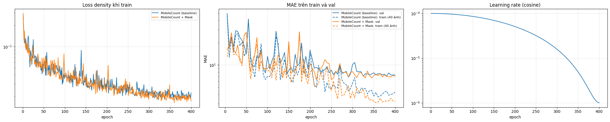

*Hình 4.5. Quá trình huấn luyện (seed 42). Trái: loss density giảm đều ở cả hai mô hình. Giữa: val MAE (nét liền) dao động mạnh tới khoảng epoch 250, rồi ổn định khi learning rate nhỏ dần; train MAE (nét đứt, đo trên 40 ảnh train) vẫn giảm tới cuối, của Mask thấp hơn baseline. Val MAE không tăng lại ở cuối, tức là chưa overfit. Phải: learning rate cosine từ 1e-4 xuống 1e-6.*

---

## 5. Triển khai hệ thống

### 5.1. Kiến trúc phần mềm

Ứng dụng web chạy trên máy cá nhân, chỉ cần CPU.
- **Backend:** Python, FastAPI, quản lý gói bằng uv.
- **Frontend:** React, Vite.

Mã nguồn nằm ở thư mục `demo/`; hướng dẫn cài đặt ở `demo/README.md`.

**Model:** hai checkpoint ở `demo/models/` (bảng cuối mục 4.3). Người vận hành chọn MobileCount + Mask (mặc định) hoặc baseline ngay trên web khi đang chạy. Vì hai model đếm lệch nhau, đổi model sẽ học lại mức bình thường. Model không có nhánh mask thì không vẽ đường bao vùng đám đông, và optical flow tính trên toàn vùng giám sát.

**Hai luồng xử lý:**
- **Luồng đọc:** lấy frame ở FPS gốc của nguồn, ghép lớp nhận diện mới nhất, gửi lên trình duyệt dạng MJPEG. Video luôn mượt, không phải chờ mô hình.
- **Luồng phân tích:** lấy frame mới nhất, chạy mô hình, optical flow và các luật, rồi cập nhật lớp nhận diện và cơ sở dữ liệu. Phần vẽ lớp nhận diện chỉ dựng lại sau mỗi lần phân tích, nên chi phí ghép lên từng frame rất nhỏ.

**Nguồn video:**
- *File có sẵn* (mp4, webm, mkv, avi, mov, ts): phát đúng nhịp, lặp lại, tạm dừng, tua.
- *Livestream YouTube:* lấy luồng HLS qua yt-dlp. Mốc thời gian theo nhịp video để frame được phát đều; tự kết nối lại khi rớt mạng.

**Lưu trữ (SQLite):**
- Bảng `samples`: mỗi lần phân tích ghi số người tổng, trong vùng, trong vùng loại trừ, ô đông nhất, cùng 3 đặc trưng chuyển động.
- Bảng `events`: mỗi cảnh báo ghi thời điểm, loại, giá trị, ngưỡng, thông điệp, cùng đường dẫn **ảnh bằng chứng** (khung hình có lớp nhận diện) và **clip H.264** khoảng 5 giây trước và 5 giây sau sự kiện, lấy từ bộ đệm frame.

**Kiểm thử:**
- 60 kiểm thử tự động (pytest) cho từng module: mô hình, vùng, mật độ, optical flow, luật, lưu trữ, bằng chứng, nguồn video, vẽ lớp phủ, pipeline, API.
- Các kiểm thử chạy trên dữ liệu tổng hợp (flow đều, flow ngược chiều, hướng ngẫu nhiên, chuỗi số đếm tăng đột ngột) và trên mô hình thật.

### 5.2. Giao diện giám sát

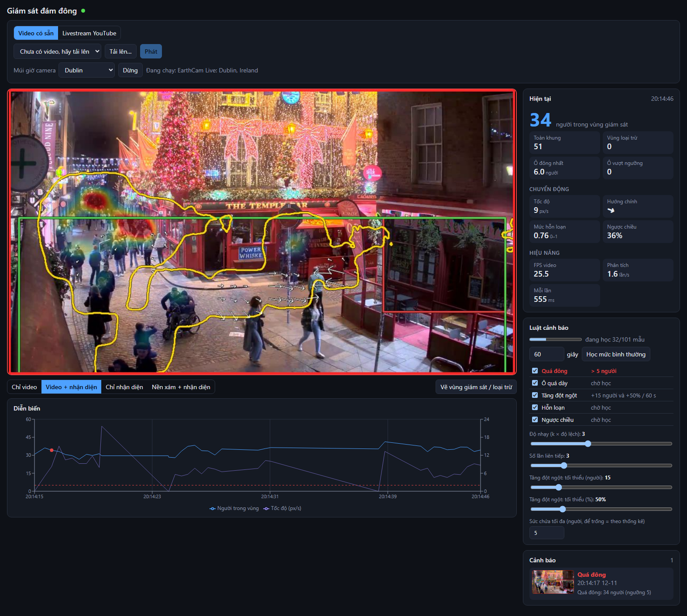

*Hình 5.1. Giao diện khi chạy trên livestream Dublin:*
- Khung video có viền đỏ vì đang có cảnh báo. ROI viền xanh, vùng loại trừ viền đỏ, đường bao vàng là vùng đám đông, mũi tên trắng là hướng chuyển động.
- Cột phải gồm số liệu hiện tại, các luật cảnh báo và danh sách cảnh báo.
- Dưới khung video là 4 chế độ hiển thị và biểu đồ diễn biến.

Bốn chế độ hiển thị trên cùng một khung hình:

| Chỉ video | Video + nhận diện |
|---|---|
| 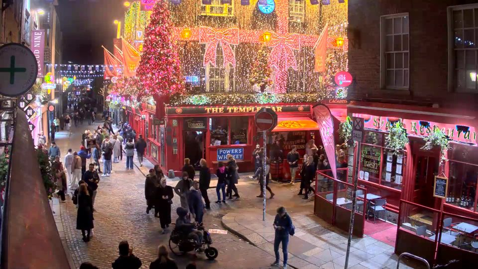 | 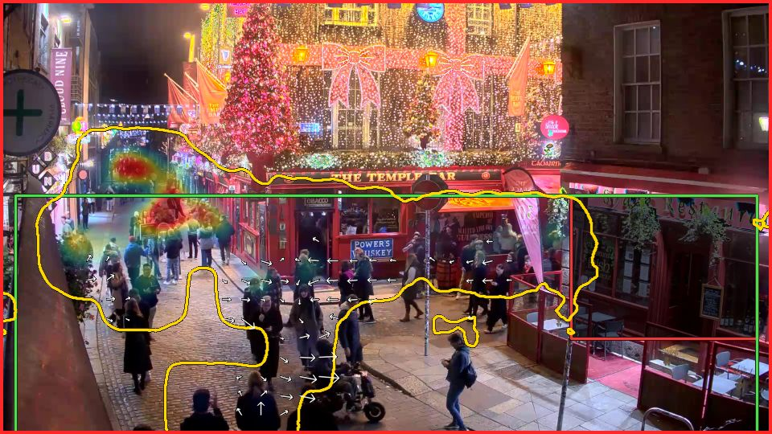 |
| **Chỉ nhận diện** | **Nền xám + nhận diện** |
| 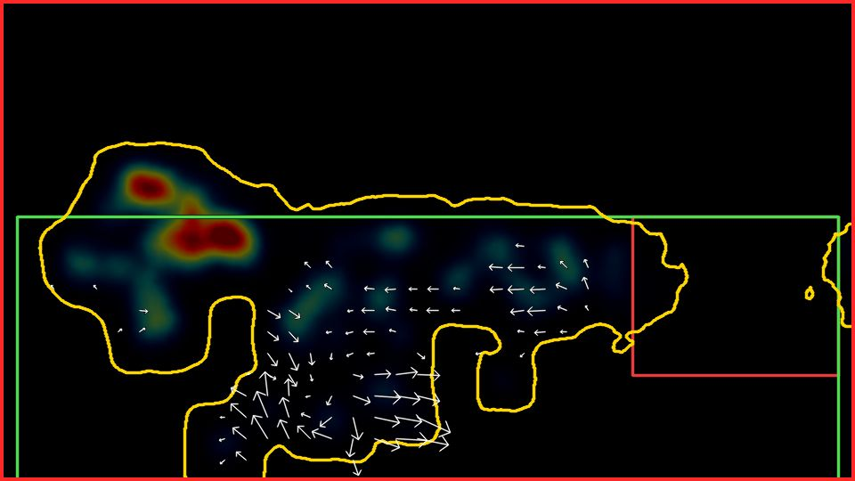 | 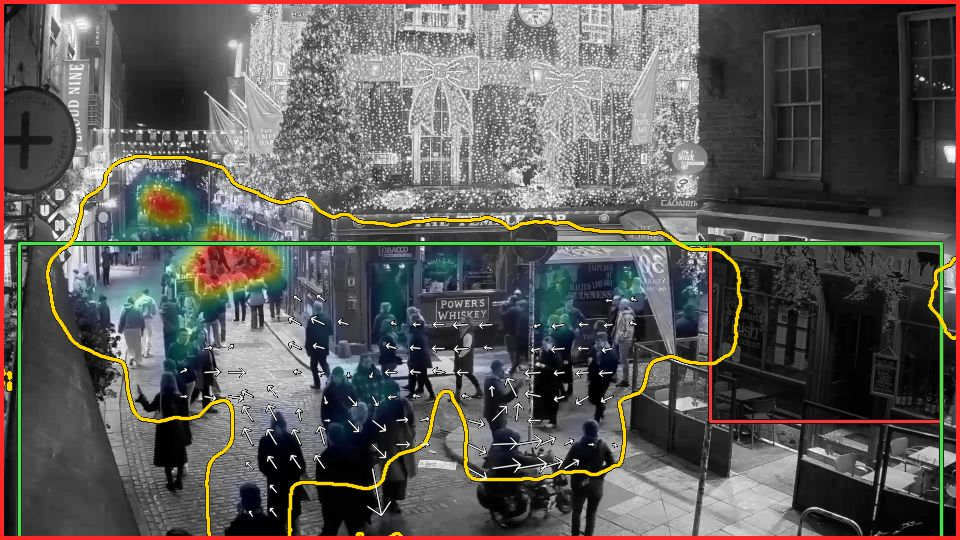 |

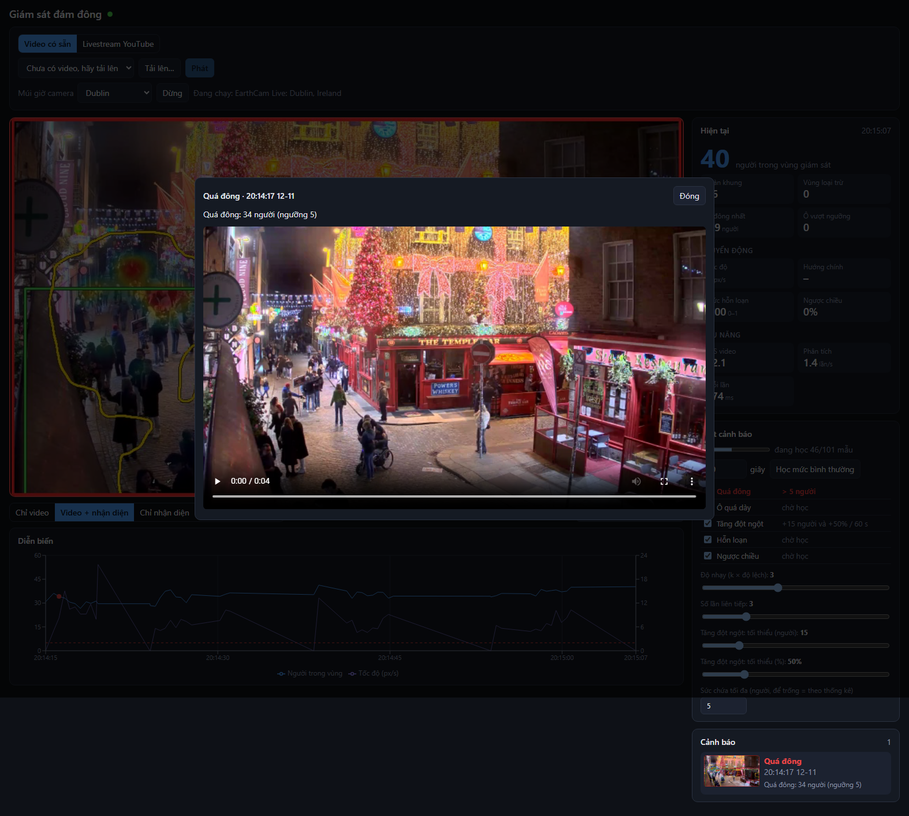

*Hình 5.2. Click vào một cảnh báo để xem clip bằng chứng trước và sau sự kiện.*

| MobileCount (baseline) | MobileCount + Mask |
|---|---|
| 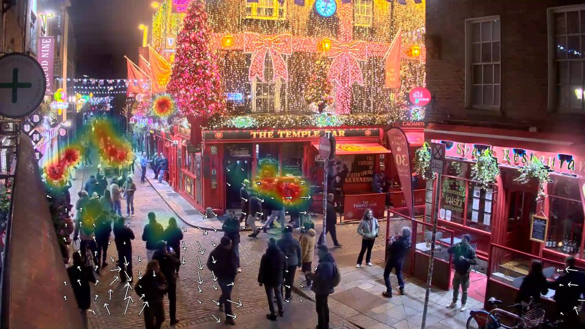 | 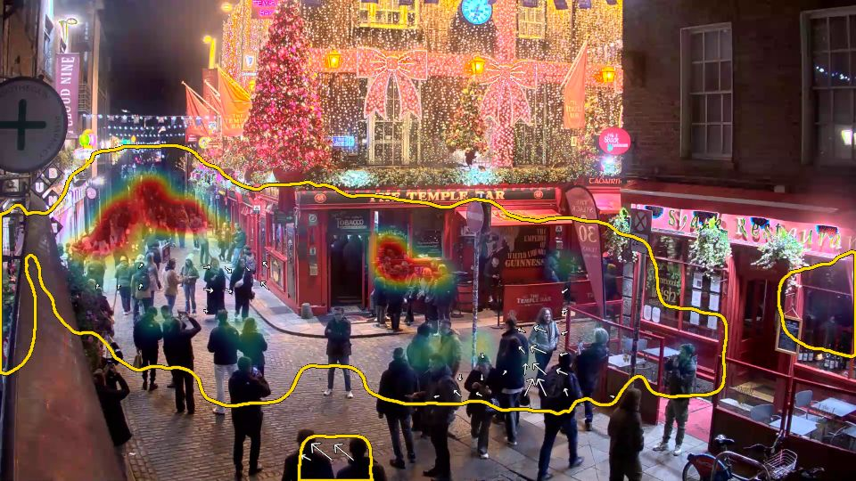 |

*Hình 5.3. Hai model trên bản ghi Temple Bar, Dublin (hai khung hình cách nhau vài giây, chưa vẽ vùng loại trừ). Với model Mask, đường bao vàng khoanh dải đám đông giữa phố và mũi tên chuyển động chỉ vẽ trong đó; với baseline, mũi tên trải ra cả những chỗ không có người. Cả hai model đều đặt mật độ lên đèn trang trí bên trái, nên cần vùng loại trừ.*

### 5.3. Chạy trên camera thật

Quan sát khi chạy trên livestream EarthCam Dublin (1920×1080, 30 FPS, ban đêm):
- Heatmap mật độ tập trung đúng vào đầu người; đường bao mask khoanh được các nhóm người trên phố.
- **Đèn trang trí Giáng sinh và biển hiệu phát sáng** đôi khi bị đếm thành người, vì ảnh huấn luyện là ảnh ban ngày ở Thượng Hải. Vẽ vùng giám sát chỉ phủ mặt phố đã loại bỏ phần lớn lỗi này. Ví dụ ở hình 5.1: toàn khung đếm được 51 người, trong vùng giám sát là 34 người.
- Optical flow thể hiện đúng hai luồng người đi ngược chiều nhau trên phố. Trên phố hai chiều, tỉ lệ ngược chiều lúc bình thường thay đổi theo từng thời điểm: gần 0 khi chỉ một nhóm đi qua, nhưng cao khi hai nhóm đi ngược nhau cùng lúc. Vì vậy luật ngược chiều cần cả ngưỡng học theo camera lẫn mức sàn (mục 6).
- **Người ở gần camera** (phần dưới khung hình, đầu to hơn nhiều so với ảnh huấn luyện) có mật độ dự đoán thấp và thường nằm ngoài đường bao mask. Ảnh ShanghaiTech chủ yếu có đầu nhỏ ở xa (hình 4.2), nên đây cũng là lỗi do chênh lệch miền dữ liệu.

### 5.4. Hiệu năng

Đo trên máy 12 nhân CPU, không dùng GPU, với livestream 1920×1080 30 FPS, ảnh phân tích rộng 960 px:

| Đại lượng | Giá trị |
|---|---|
| FPS video hiển thị | 25–28 (nguồn 30) |
| Tần suất phân tích (mô hình, flow, luật) | 1,5–1,6 lần/giây |
| Thời gian mỗi lần phân tích | 550–600 ms |
| Độ trễ lớp nhận diện so với hình | khoảng 0,6 s |
| Độ trễ cảnh báo sau khi điều kiện bắt đầu đúng | 6 s thời gian duy trì (chỉnh được trên web), cộng tối đa một lần phân tích |

Ở lần thử đầu, video chỉ đạt khoảng 20 FPS vì lớp phủ được tính lại cho từng frame. Sau khi chuyển sang dựng lớp phủ một lần cho mỗi lần phân tích, và giới hạn số luồng của PyTorch ở một nửa số nhân, video đạt 25–28 FPS.

---

## 6. Đánh giá phát hiện bất thường

**Kiểm thử trên chuỗi giả lập** (kiểm thử tự động trong `demo/backend/tests/test_rules.py`):

| Kịch bản | Kết quả |
|---|---|
| Chưa học xong mức bình thường | Không có cảnh báo thống kê; ngưỡng sức chứa do người vận hành đặt vẫn có hiệu lực |
| Số người vượt ngưỡng dưới thời gian duy trì rồi trở lại bình thường | Không báo |
| Vượt ngưỡng kéo dài | Báo đúng 1 lần khi đủ thời gian duy trì, không báo lặp |
| Đợt mới trong vòng 60 s sau cảnh báo trước | Không báo; nếu đợt còn kéo dài sau 60 s thì nhắc lại |
| Học mức bình thường lúc phố vắng, không ai đi ngược | Ngưỡng vẫn ≥ mức sàn (≥ 15 người khi trung vị 10; ≥ 4 người/ô; ≥ 30% ngược chiều) |
| Phố đông dần lên trong 20 phút | Ngưỡng quá đông tăng theo |
| Số người tăng từ 60 lên 110 trong 20 giây (phân tích mỗi 2 giây) | Phát hiện "tăng đột ngột" sau tối đa 10 lần phân tích, tức trong 20 giây kể từ lúc bắt đầu tăng |
| Chỉ tốc độ tăng (cùng một hướng) | Không báo hỗn loạn |
| Tốc độ và mức hỗn loạn cùng tăng | Báo "hỗn loạn" |
| Tỉ lệ ngược chiều tăng từ khoảng 10% lên 50% | Báo "ngược chiều" |

**Trên camera thật:**
- Toàn bộ chuỗi đã được kiểm tra trên livestream Dublin bằng cách đặt sức chứa tối đa thấp: phát hiện, ghi ảnh, ghi clip H.264, lưu vào SQLite và hiển thị trên web đều hoạt động (hình 5.2).

**Phân tích báo nhầm (mức thiết kế).** Ngưỡng dạng trung vị + k·σ chỉ đáng tin khi dữ liệu học đủ đa dạng. Ba tình huống dễ gây báo nhầm, và cơ chế xử lý tương ứng:

| Tình huống | Vì sao báo nhầm | Cơ chế xử lý |
|---|---|---|
| Học mức bình thường đúng lúc cảnh vắng hoặc đứng yên | σ ≈ 0 (ví dụ không ai đi ngược chiều thì trung vị và MAD đều bằng 0), ngưỡng sát mức hiện tại, thay đổi nhỏ cũng vượt | Mức sàn cho mọi ngưỡng (5 người, 4 người/ô, 30% ngược chiều); học 5 phút thay vì vài chục giây |
| Nhịp cảnh thay đổi trong ngày (phố đông dần lên buổi tối) | Ngưỡng học lúc vắng bị vượt kéo dài | Mức nền cập nhật mỗi 30 s theo 15 phút gần nhất; giới hạn cứng là sức chứa tối đa do người vận hành đặt |
| Dao động ngắn (một nhóm người đi ngang, hai nhóm đi ngược nhau thoáng qua) | Điều kiện đúng trong vài giây rồi hết | Phải đúng liên tục 6 s mới báo; mỗi đợt báo một lần; 60 s nghỉ giữa hai cảnh báo cùng loại |

Các cơ chế này được kiểm chứng bằng kiểm thử tự động trên chuỗi giả lập (bảng trên). Tỉ lệ báo nhầm thực tế (số cảnh báo mỗi giờ trên bản ghi dài) và độ chính xác trên dataset UMN chưa được đo; đây là hướng phát triển (mục 8).

---

## 7. Thảo luận

### 7.1. Hạn chế

- **Chênh lệch miền dữ liệu:** mô hình học trên ảnh ban ngày ở Thượng Hải, còn camera thật có cảnh đêm, đèn trang trí và góc nhìn cao. Hiện mới xử lý bằng vùng loại trừ; chưa đo được sai số trên camera thật và chưa fine-tune.
- **Phối cảnh:** số người mỗi ô và tốc độ tính theo pixel. Người và ô ở xa camera thực tế chiếm diện tích mặt đất lớn hơn, nên cùng số đo có ý nghĩa khác nhau theo vị trí trong khung hình.
- **Ablation một seed:** baseline và MobileCount + Mask đã có 3 seed, nhưng các hướng C2, C5, C1 + C5 mới huấn luyện một lần. Kết luận "không cải thiện" của các hướng này còn có thể đổi khi thêm seed.
- **Chưa đo tỉ lệ báo nhầm thực tế:** các ngưỡng và cơ chế chống báo nhầm mới được thiết kế theo phân tích và kiểm thử giả lập. Người vận hành vẫn có thể chỉnh thời gian duy trì, độ nhạy hoặc đặt sức chứa tối đa trên web cho phù hợp từng địa điểm.
- **Camera rung hoặc zoom:** cả khung hình cùng chuyển động, có thể gây báo nhầm luật hỗn loạn.
- **Độ trễ lớp nhận diện** khoảng 0,6 s trên CPU.

### 7.2. An toàn thông tin và quyền riêng tư

Hệ thống giám sát nơi công cộng xử lý hình ảnh của người dân, nên thiết kế ưu tiên tối thiểu hóa dữ liệu cá nhân:
- **Không nhận dạng cá nhân:** mô hình chỉ ước lượng mật độ, không phát hiện khuôn mặt, không theo dõi hay định danh từng người. Dữ liệu lưu lâu dài trong `samples` chỉ là các con số tổng hợp.
- **Bằng chứng có giới hạn:** chỉ khi có cảnh báo mới lưu một ảnh và một clip khoảng 10 giây. Bộ đệm frame chỉ giữ vài giây gần nhất trong bộ nhớ.
- **Xử lý cục bộ:** mọi phân tích và lưu trữ diễn ra trên máy chạy hệ thống; ứng dụng chỉ lắng nghe ở địa chỉ nội bộ (127.0.0.1), không gửi hình ảnh ra ngoài.
- **Hướng hoàn thiện khi triển khai thật:**
  - Xác thực người dùng cho dashboard.
  - Thời hạn lưu và tự xóa bằng chứng.
  - Làm mờ khuôn mặt trong ảnh bằng chứng.
  - Ghi nhật ký truy cập.

---

## 8. Kết luận và hướng phát triển

Đề tài đã xây dựng một hệ thống giám sát đám đông hoàn chỉnh:
- Một mô hình đếm người nhẹ được cải tiến bằng nhánh mask, giảm một nửa lỗi đếm nhầm ở nền và cải thiện MAE ổn định khi dùng checkpoint epoch cuối (8,91 so với 9,37, cả 3 seed); với checkpoint chọn theo val thì MAE và MSE ngang baseline.
- Một ứng dụng chạy thời gian thực trên CPU, kết hợp phân tích mật độ, vùng giám sát, optical flow và các luật có ngưỡng tự học, với bằng chứng cho từng cảnh báo.

Hướng phát triển:
1. Gán nhãn frame camera thật để đo sai số và fine-tune, giảm lỗi do đèn và biển hiệu.
2. Đánh giá định lượng phần phát hiện bất thường trên dataset UMN và trên bản ghi dài.
3. Autoencoder trên chuỗi đặc trưng chuyển động, để bắt các dạng bất thường chưa có luật.
4. Hiệu chỉnh phối cảnh để tính người/m² và m/s; quy định hướng đi cho từng vùng giám sát.
5. Huấn luyện thêm seed cho các phiên bản ablation (hiện chỉ baseline và MobileCount + Mask có 3 seed).
6. Thông báo qua email hoặc Telegram, giám sát nhiều camera, dự đoán nguy cơ quá tải; chuyển sang livestream Shinsaibashi khi lấy được luồng.

---

## 9. Tài liệu tham khảo

1. Y. Zhang, D. Zhou, S. Chen, S. Gao, Y. Ma. *Single-Image Crowd Counting via Multi-Column Convolutional Neural Network* (MCNN). CVPR 2016.
2. Y. Li, X. Zhang, D. Chen. *CSRNet: Dilated Convolutional Neural Networks for Understanding the Highly Congested Scenes*. CVPR 2018. https://arxiv.org/abs/1802.10062
3. P. Wang, C. Gao, Y. Wang, H. Li, Y. Gao. *MobileCount: An Efficient Encoder-Decoder Framework for Real-Time Crowd Counting*. Neurocomputing, 2020.
4. Z. Shi, P. Mettes, C. Snoek. *Counting with Focus for Free*. ICCV 2019.
5. L. Zhu, Z. Zhao, C. Lu, Y. Lin, Y. Peng, T. Yao. *Dual Path Multi-Scale Fusion Networks with Attention for Crowd Counting* (SFANet). arXiv 2019.
6. M. Sandler, A. Howard, M. Zhu, A. Zhmoginov, L.-C. Chen. *MobileNetV2: Inverted Residuals and Linear Bottlenecks*. CVPR 2018.
7. V. Nekrasov, C. Shen, I. Reid. *Light-Weight RefineNet for Real-Time Semantic Segmentation*. BMVC 2018.
8. G. Farnebäck. *Two-Frame Motion Estimation Based on Polynomial Expansion*. SCIA 2003.
9. ShanghaiTech Crowd Counting Dataset. https://www.kaggle.com/datasets/tthien/shanghaitech
10. OpenCV Optical Flow. https://docs.opencv.org/4.x/d4/dee/tutorial_optical_flow.html
11. R. Mehran, A. Oyama, M. Shah. *Abnormal Crowd Behavior Detection using Social Force Model*. CVPR 2009.

---

## Phụ lục

### A. Hướng dẫn chạy

| Thành phần | Nơi chạy | Ghi chú |
|---|---|---|
| `baseline_mobilecount.ipynb` | Kaggle, GPU T4 | Baseline, khoảng 45 phút |
| `improved_mobilecount.ipynb` | Kaggle, GPU T4 | Ablation C1, C2, C5, C1+C5, C3; khoảng 4–5 giờ |
| `final_mobilecount.ipynb` | Kaggle, GPU T4 | Baseline và MobileCount + Mask từ đầu, 3 seed, EDA, bảng so sánh cuối; khoảng 5 giờ |
| `final-mobilecount-tr-n-shanghaitech.ipynb` | – | Bản đã chạy của notebook trên, kèm output |
| `results/` | – | Kết quả tải từ Kaggle: bảng CSV, lịch sử huấn luyện, dự đoán từng ảnh, hình, checkpoint (`*.pth` không đưa lên git) |
| `record_shinsaibashi.ipynb` | Kaggle, CPU | Ghi livestream thành video để làm dữ liệu |
| `app_shinsaibashi.ipynb` | Kaggle, GPU | Bản xử lý theo lô của ứng dụng (ROI, luật, video kết quả) |
| `demo/` | Máy cá nhân, CPU | Ứng dụng web; xem `demo/README.md`. Model ở `demo/models/`, bản ghi Dublin 30 phút ở `demo/data/videos/` |

Dữ liệu trên Kaggle: dataset `tthien/shanghaitech`.

### B. Đối chiếu với yêu cầu đề tài

| Yêu cầu (de.md) | Mục trong báo cáo | Tình trạng |
|---|---|---|
| 1.1 Detection và density; MCNN, CSRNet, MobileCount; dataset | 2.1, 2.2, 4.1 | Đã làm |
| 1.2 Các dạng bất thường; optical flow; autoencoder, thống kê, Social Force | 2.3, 3.4, 3.5 | Optical flow và thống kê: đã làm. Autoencoder, Social Force: hướng phát triển |
| 2.1 Dữ liệu chuẩn và video thực tế | 4.1, 5.3 | Đã làm (ShanghaiTech; livestream và bản ghi) |
| 2.2 Baseline, MAE/MSE, fine-tune | 4.3, 4.4 | Đã làm; fine-tune trên camera thật: chưa |
| 3.1 Pipeline thời gian thực, chuỗi thời gian | 5.1, 5.4 | Đã làm |
| 3.2 Heatmap | 5.2 | Đã làm |
| 3.3 Bất thường theo mật độ, ROI | 3.3, 3.5 | Đã làm |
| 3.4 Bất thường theo chuyển động | 3.4, 3.5 | Farneback và luật thống kê: đã làm. RAFT, autoencoder: hướng phát triển |
| 4.1 Cơ sở dữ liệu | 5.1 | Đã làm (SQLite) |
| 4.2 Dashboard, bằng chứng, xem lại | 5.2 | Đã làm. Email, thông báo đẩy: hướng phát triển |
| 5.1 MAE trên video thật | 5.3, 8 | Đánh giá định tính trên camera thật; đo MAE (cần gán nhãn): hướng phát triển |
| 5.2 Kiểm thử bất thường, độ trễ, báo động giả | 6 | Kiểm thử giả lập và phân tích báo nhầm ở mức thiết kế: đã làm. Đo tỉ lệ báo nhầm thực tế, UMN: hướng phát triển |
| 5.3 FPS toàn pipeline | 5.4 | Đã làm |
| 5.4 Đa camera, action recognition, dự đoán quá tải | 8 | Hướng phát triển |
